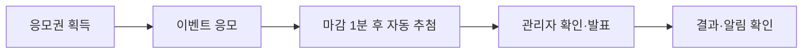
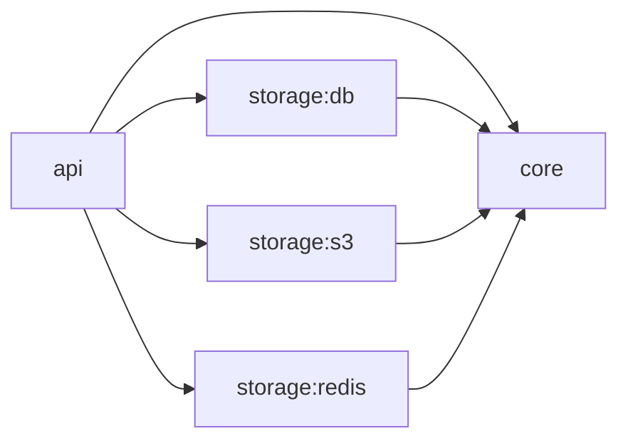

<div align="center">
  
  <h1>GETDDO Backend</h1>
  <p><strong>참여는 즐겁게, 응모와 추첨은 정확하게.</strong></p>
</div>

## 바로가기

| 구분 | 링크 |
| --- | --- |
| 서비스 | [GETDDO 사용자·관리자 화면](https://getddo-fe.vercel.app/) |
| API 문서 | [Swagger UI](https://dzc8oneey9mmx.cloudfront.net/swagger-ui/index.html) |
| 공용 명세 | [요구사항·도메인·API 계약](https://github.com/Uplus-GETDDO/getddo-spec) |
| 상세 문서 | [Backend Wiki](https://github.com/Uplus-GETDDO/getddo-be/wiki) · [구현·운영 문서](docs/) |

## 목차

1. [프로젝트 개요](#프로젝트-개요)
2. [기술 스택](#기술-스택)
3. [백엔드 팀 구성 및 역할](#백엔드-팀-구성-및-역할)
4. [아키텍처](#아키텍처)
5. [ERD](#erd)
6. [주요 설계](#주요-설계)
7. [정합성 검증](#정합성-검증)
8. [프로젝트 수행 경과](#프로젝트-수행-경과)
9. [실행 방법](#실행-방법)

## 프로젝트 개요

GETDDO는 LG유플러스 멤버십 사용자를 위한 **이벤트 응모·추첨 플랫폼**입니다. 출석·미션·게임으로 응모권을 모으고, 이벤트에 참여해 당첨 결과를 확인합니다.

| 사용자 | 관리자 |
| --- | --- |
| 출석·퀴즈·설문·게임을 통한 응모권 획득 | 이벤트·경품·이미지·배너 관리 |
| 이벤트 조회·응모, 응모권 잔액·내역 확인 | 응모·응모권·사용자·일별 현황 조회 |
| 발표된 당첨 결과·알림 확인 | 추첨 검토·발표·재추첨, 이벤트 취소·반환 |



기본 이벤트는 `NO_TICKET`(응모권 미사용), 겟또타임은 `TICKET`(응모권 사용)입니다. 사용자 멤버십과 응모권 등급은 별개의 기준입니다.

시연은 사전 등록된 가상 사용자 선택 방식입니다. 요청의 `X-User-*` 헤더를 DB 사용자 정보와 대조하며, 별도 회원가입·로그인 토큰 발급은 제공하지 않습니다. [사용자 문맥 안내](docs/02-api/user-profile.md)

## 기술 스택

| 구분 | 기술 |
| --- | --- |
| Language | Java 21 |
| Framework | Spring Boot 4.1.1 · Spring MVC |
| Data Access | Spring Data JPA · JDBC |
| Database | MySQL 8.4 · Redis · Flyway |
| Build | Gradle 9.7.1 |
| Test | JUnit · Mockito · Testcontainers |
| DevOps | Docker · Docker Compose · GitHub Actions |
| API Docs | Swagger UI |

## 백엔드 팀 구성 및 역할

| 팀원 | 담당 영역 |
| --- | --- |
| 이경주 | 인프라·CI/CD·공통 기반·사용자 |
| 석종수 | 응모 자동 차단 이력·추첨·결과 공개·재추첨 |
| 전민규 | 백오피스·배너·알림·게임 |
| 윤태형 | 응모권·출석·미션·이벤트 응모·요청 빈도 제한 |
| 박지훈 | 이벤트·경품 CRUD·이미지 업로드·모집 상태 전환·취소 |

## 아키텍처

### 시스템 아키텍처

[](docs/assets/cloud-architecture.png)

### 모듈 의존 관계



| 모듈 | 역할 |
| --- | --- |
| api | HTTP 요청·입력 검증·응답 변환·애플리케이션 실행 |
| core | 도메인 모델·업무 규칙·Service·트랜잭션·Repository 계약 |
| storage:db | JPA·JDBC 저장 구현·Entity·Mapper·Flyway |
| storage:s3 | 이미지 저장과 AWS SDK 연동 |
| storage:redis | 요청 제한·응모 자동 차단·Lua 실행 |

`api`를 하나의 Spring Boot 애플리케이션으로 실행합니다. `core`는 HTTP DTO와 저장소 구현에 의존하지 않습니다.

### 패키지 구조

`<도메인>`은 `user`, `event`, `ticket` 등 기능별 패키지를 뜻합니다.

```text
getddo-be/
├── api/                                         # HTTP 요청·응답과 애플리케이션 실행
│   ├── build.gradle                             # 웹·검증·API 문서 의존성
│   └── src/
│       ├── main/
│       │   ├── java/com/getddo/api/
│       │   │   ├── GetddoBeApplication.java     # Spring Boot 진입점
│       │   │   ├── common/                      # API 공통 처리
│       │   │   │   ├── config/                  # MVC·CORS·OpenAPI 설정
│       │   │   │   ├── context/                 # 사용자 문맥 어노테이션·ArgumentResolver
│       │   │   │   ├── exception/               # 공통 API 오류 코드·전역 예외 처리
│       │   │   │   ├── ratelimit/               # 요청 제한·응모 차단 인터셉터와 설정
│       │   │   │   └── response/                # 공통 응답 형식 ResponseEnvelope
│       │   │   └── <도메인>/
│       │   │       ├── controller/              # 요청을 받아 Service에 위임
│       │   │       ├── dto/request/             # 요청 DTO와 입력 검증
│       │   │       └── dto/response/            # 응답 DTO·from(domain) 변환
│       │   └── resources/                       # application.yaml 등 실행 설정
│       ├── test/                                # DB 없는 API·설정 테스트
│       └── integrationTest/                     # 앱 기동·API·DB 연동 테스트
├── core/                                        # 도메인 모델과 비즈니스 규칙
│   ├── build.gradle                             # Spring Context·트랜잭션 의존성
│   └── src/
│       ├── main/java/com/getddo/core/
│       │   ├── common/                          # 공통 예외·페이지 조회 모델·시각 처리
│       │   └── <도메인>/
│       │       ├── domain/                      # 도메인 객체·상태·비즈니스 규칙
│       │       ├── service/                     # 업무 흐름과 트랜잭션
│       │       ├── repository/                  # 조회·저장 인터페이스
│       │       └── exception/                   # 도메인 오류 코드(ErrorCode 구현)
│       └── test/                                # 도메인 규칙·Service 테스트
├── storage/                                     # 저장소 구현 모듈의 경로 구분
│   ├── redis/                                   # Redis 제한기·Lua·연결 풀 및 Redis 전용 테스트
│   ├── s3/                                      # 이벤트·경품 이미지 S3 저장 어댑터
│   │   ├── build.gradle                         # AWS SDK 의존성
│   │   └── src/main/java/com/getddo/s3/event/    # S3 클라이언트 설정·저장 구현
│   └── db/                                      # MySQL 영속성 구현
│       ├── build.gradle                         # JPA·Flyway·MySQL 드라이버 의존성
│       └── src/
│           ├── main/
│           │   ├── java/com/getddo/db/
│           │   │   ├── common/                  # 공통 Entity·JPA Auditing 설정
│           │   │   └── <도메인>/
│           │   │       ├── entity/              # DB 테이블에 대응하는 JPA Entity
│           │   │       ├── repository/          # JpaRepository·core Repository 구현
│           │   │       └── mapper/              # Entity ↔ 도메인 객체 변환
│           │   └── resources/db/migration/      # 도메인별 Flyway SQL
│           ├── test/                            # DB 없는 영속성 관련 테스트
│           ├── integrationTest/                 # 실제 MySQL·마이그레이션 검증
│           └── testFixtures/                    # 공유 Testcontainers 설정
├── .github/                                     # GitHub 협업·자동화 설정
│   ├── pull_request_template.md                 # PR 작성 양식
│   └── workflows/                               # 빌드·테스트·이미지 생성·CD·PR 제목 검사
├── infra/                                       # 인프라 정의·배포 자동화 (Gradle 모듈과 별도)
│   └── scripts/                                 # 서버 배포·설정 조회 스크립트
│       ├── deploy-ssm.py                         # 배포 파일 전달·SSM 순차 교체·결과 확인
│       ├── deploy-container.sh                   # 설정·컨테이너 교체와 실패 복구
│       ├── publish-image.py                      # main 이미지의 ECR 게시
│       ├── prepare-image.py                      # 후보·복구 이미지 사전 준비·검증
│       ├── deploy-staging.py                     # 검증한 PR 이미지의 스테이징 배포
│       ├── fetch-app-env.py                      # Parameter Store 설정 조회·검증
│       ├── daily-release.py                      # dev CI 확인·main 병합
│       └── publish-release.py                    # 배포 성공 버전 발행
├── docs/                                        # 백엔드 API·DB·결정·작업 기록
├── gradle/wrapper/                              # Gradle 실행 버전 고정
├── compose.yaml                                 # 로컬 앱·MySQL (기본 요청 제한은 memory)
├── compose.deploy.yaml                          # 서버용 앱 컨테이너 구성
├── Dockerfile                                   # 애플리케이션 이미지 빌드
├── .env.example                                 # 로컬 환경변수 예시
├── build.gradle                                 # 모듈 공통 빌드·테스트 설정
├── settings.gradle                              # 프로젝트 이름·모듈 등록
├── gradlew                                      # macOS·Linux·WSL Gradle 실행
└── gradlew.bat                                  # Windows Gradle 실행
```

## ERD

[](docs/assets/erd-2026-10-23.png)

[최신 ERDCloud](https://www.erdcloud.com/d/TD6HcLSupbKDD9Z2E) · [원본 이미지](docs/assets/erd-2026-10-23.png) · [DBML](docs/03-database/schema.dbml) · [Flyway SQL](storage/db/src/main/resources/db/migration/)

이미지는 2026-10-23의 설계 스냅샷입니다. 이후 변경은 ERDCloud와 저장소의 DB 정의를 함께 참고합니다.

### 도메인별 ERD

| 도메인 | 테이블 수 | 내용 |
| --- | ---: | --- |
| [사용자](https://github.com/Uplus-GETDDO/getddo-be/wiki/ERD-user) | 1 | 사용자 정보·역할·멤버십 |
| [이벤트·응모](https://github.com/Uplus-GETDDO/getddo-be/wiki/ERD-event) | 6 | 이벤트·경품·응모자·응모 요청·배너·배너 카탈로그 잠금 |
| [출석](https://github.com/Uplus-GETDDO/getddo-be/wiki/ERD-attendance) | 5 | 일일·연속 출석과 보상 청구 |
| [미션](https://github.com/Uplus-GETDDO/getddo-be/wiki/ERD-mission) | 10 | 퀴즈·설문·제출·보상 청구 |
| [게임](https://github.com/Uplus-GETDDO/getddo-be/wiki/ERD-game) | 6 | 게임·플레이·통계·보상·플레이 검증 근거 |
| [보상 정책](https://github.com/Uplus-GETDDO/getddo-be/wiki/ERD-reward) | 1 | 출석·미션·게임 보상 정책과 적용 기간 |
| [응모권](https://github.com/Uplus-GETDDO/getddo-be/wiki/ERD-ticket) | 2 | 응모권 한 장의 현재 상태와 처리 이력 |
| [어뷰징 차단 이력](https://github.com/Uplus-GETDDO/getddo-be/wiki/ERD-abuse) | 1 | 응모 자동 일시 차단의 시작·종료 시각과 판정 근거 |
| [추첨·발표](https://github.com/Uplus-GETDDO/getddo-be/wiki/ERD-drawing) | 11 | 추첨 실행·후보·결과·확인·공개 버전과 실패 이력 |
| [알림](https://github.com/Uplus-GETDDO/getddo-be/wiki/ERD-notification) | 2 | 알림 생성 작업과 사용자 알림 |
| [감사 로그](https://github.com/Uplus-GETDDO/getddo-be/wiki/ERD-audit) | 1 | 변경 행위와 변경 전후 데이터 |

## 주요 설계

| 문제 | 적용한 방식 |
| --- | --- |
| 중복 요청·동시 차감 | 요청 ID·행 잠금·DB 유일 제약으로 중복 지급과 초과 사용 방지 |
| 업무 기록 불일치 | 응모·차감·이력과 취소·반환을 각각 같은 트랜잭션으로 처리 |
| 추첨 근거와 공개 결과 | 후보·가중치·조건을 보존하고 결과 확정과 관리자 발표를 분리 |
| 비동기 작업 실패 | 작업 선점·진행 위치·재시도로 중복 처리와 중간 실패에 대응 |
| 코드 책임 분리 | 모듈과 기능별 패키지로 HTTP·업무·저장소 구현의 변경 경계를 구분 |

## 정합성 검증

로컬과 API 서버 2대의 스테이징에서 동시 요청·재시도·마감·자정 경계를 시험했습니다. 아래는 2026-10-24~26 스테이징에서 측정한 대표 결과입니다.

| 시나리오 | 측정 결과 |
| --- | --- |
| 마감 직전 응모 3회 | 접수 1,522건, 접수 시각이 마감 이후인 응모 0건, 후보·접수 응모 ID 집합 일치 |
| 사용자 100명의 동시 응모 | 접수 220건 = 차감 220장 = 사용 이력 220건, 같은 키를 5번 보낸 사용자는 각 1건 접수 |
| 응모 중 이벤트 취소 2회 | 수락 26건·25건 모두 차감·반환 1:1, 거절 응모의 차감 0건 |
| 자정 전후 출석 1,000회 요청 | 총 출석 246건 = 일일 보상 청구 246건 = 지급 응모권 246장 |
| 추첨 결과 SQL 점검 | 당첨 304건에서 후보 밖 당첨·같은 실행의 중복 당첨·경품별 인원 초과 0건 |

시험별 환경·결과는 [정합성 검증 Wiki](https://github.com/Uplus-GETDDO/getddo-be/wiki/Consistency-Verification), 기능별 테스트 기록은 [테스트 Wiki](https://github.com/Uplus-GETDDO/getddo-be/wiki/Mentoring-Tests)를 참고합니다.

## 프로젝트 수행 경과

도메인별 주요 기능과 설계를 요약했습니다. 처리 흐름·선택 이유·검증 근거는 각 문서에서 확인할 수 있습니다.

<details>
<summary>인프라·CI/CD</summary>

- Docker·GitHub Actions로 빌드·테스트·이미지 생성과 서버 배포를 자동화합니다.
- 서버를 순차 교체하고 배포 실패 시 이전 이미지로 복구합니다.

[CI/CD·복구](https://github.com/Uplus-GETDDO/getddo-be/wiki/CI-CD-Release-Recovery) · [Docker Compose 선택](https://github.com/Uplus-GETDDO/getddo-be/wiki/Docker-Compose-Choice)
</details>

<details>
<summary>공통 기반</summary>

- 공통 응답·오류·사용자 문맥·시간·페이지 조회·감사 기록을 제공합니다.
- 기능별 Service가 공통 기반을 재사용하고 업무별 검증을 수행합니다.

[Wiki](https://github.com/Uplus-GETDDO/getddo-be/wiki/Mentoring-Features#common) · [공통 API 안내](docs/02-api/README.md)
</details>

<details>
<summary>사용자</summary>

- 가상 사용자 조회·선택과 역할·멤버십에 따른 사용자 문맥을 제공합니다.
- 요청 헤더와 DB 사용자 정보를 대조하고 관리자 기능의 권한을 검사합니다.

[Wiki](https://github.com/Uplus-GETDDO/getddo-be/wiki/Mentoring-Features#user)
</details>

<details>
<summary>이벤트·경품 관리·이벤트 취소</summary>

- 사용자·관리자 조회, 이벤트·경품 CRUD, 썸네일·상세·경품 이미지 업로드를 제공합니다.
- 시작·마감 상태를 자동 전환하고, 취소 시 응모권 반환·알림 작업·감사 기록을 함께 처리합니다.

[Wiki](https://github.com/Uplus-GETDDO/getddo-be/wiki/Mentoring-Event-Flows)
</details>

<details>
<summary>출석</summary>

- 일일·연속 출석과 단계별 보상, 관리자 보상 정책 예약을 제공합니다.
- KST 날짜를 기준으로 기록하고 같은 날의 중복 출석·보상을 방지합니다.

[Wiki](https://github.com/Uplus-GETDDO/getddo-be/wiki/Mentoring-Domain-Flows#출석)
</details>

<details>
<summary>미션</summary>

- 퀴즈·설문 제출, 완료 보상과 관리자 미션·설문 집계를 제공합니다.
- 제출 기록과 보상을 함께 확정하고 재전송·동시 제출의 중복 지급을 방지합니다.

[Wiki](https://github.com/Uplus-GETDDO/getddo-be/wiki/Mentoring-Domain-Flows#미션)
</details>

<details>
<summary>응모권</summary>

- 브론즈·실버·골드·플래티넘 응모권의 지급·차감·반환·만료와 이력을 관리합니다.
- 응모권별 상태와 이력을 보존하고 이벤트 취소 시 사용한 응모권을 원래 등급으로 반환합니다.

[Wiki](https://github.com/Uplus-GETDDO/getddo-be/wiki/Mentoring-Domain-Flows#응모권)
</details>

<details>
<summary>이벤트 응모</summary>

- 응모권 사용·미사용 이벤트의 접수와 추가 응모·접수 내역 조회를 제공합니다.
- 이벤트 상태·기간·멤버십·상한을 검사하고 접수·차감·이력을 함께 확정합니다.

[Wiki](https://github.com/Uplus-GETDDO/getddo-be/wiki/Mentoring-Domain-Flows#이벤트-응모)
</details>

<details>
<summary>요청 빈도 제한</summary>

- 사용자별 요청 횟수를 제한하고 초과 요청에 재시도 가능 시각을 안내합니다.
- Redis 공유 카운터로 여러 API 서버에 들어온 요청을 함께 집계합니다.

[Wiki](https://github.com/Uplus-GETDDO/getddo-be/wiki/Mentoring-Domain-Flows#요청-빈도-제한)
</details>

<details>
<summary>추첨·결과 공개</summary>

- 최초 자동 추첨, 결과 검증·관리자 발표·개별 당첨 취소·재추첨을 제공합니다.
- 실행별 후보·가중치·조건·결과를 보존하고 확정 결과와 공개 명단을 분리합니다.

[Wiki](https://github.com/Uplus-GETDDO/getddo-be/wiki/Mentoring-Drawing-Sequences)
</details>

<details>
<summary>응모 자동 일시 차단·이력 조회</summary>

- 반복 요청 초과 시 응모를 일시 차단하고 관리자가 차단 이력을 조회합니다.
- Redis에서 판정·저널을 기록하고 별도 워커가 근거를 MySQL에 저장합니다.

[구현·운영 문서](docs/02-api/abuse-cases.md)
</details>

<details>
<summary>알림</summary>

- 이벤트 시작·일정 변경·취소·결과 안내와 내 알림 조회·읽음 처리를 제공합니다.
- 업무 변경 시 알림 작업을 등록하고 워커가 생성·모의 발송·실패 재시도를 처리합니다.

[Wiki](https://github.com/Uplus-GETDDO/getddo-be/wiki/Mentoring-Notification-Flows)
</details>

<details>
<summary>게임</summary>

| 타꼬런 | 글자색깔 맞추기 | 타꼬 타이밍 | 타꼬 주문 |
| --- | --- | --- | --- |
|  |  |  |  |

- 글자색깔 맞추기·타꼬런·타꼬 타이밍·타꼬 주문의 시작·결과·통계·일일 보상을 제공합니다.
- 서버가 저장된 규칙과 입력을 검증하고 결과·통계·보상을 함께 확정합니다.

[Wiki](https://github.com/Uplus-GETDDO/getddo-be/wiki/Mentoring-Game-Flows)
</details>

<details>
<summary>백오피스·배너</summary>

- 관리자 사용자·참여·응모권·일별 집계 조회와 배너 등록·수정·삭제·순서 관리를 제공합니다.
- 배너 순서 변경을 원자적으로 처리하고 사용자 화면에는 공개 이미지 URL을 제공합니다.

[백오피스 Wiki](https://github.com/Uplus-GETDDO/getddo-be/wiki/Mentoring-Backoffice-Flows) · [배너 Wiki](https://github.com/Uplus-GETDDO/getddo-be/wiki/Mentoring-Banner-Flows)
</details>

## 실행 방법

### Docker Compose

Docker를 준비하고 `.env.example`을 `.env`로 복사한 뒤 `DB_PASSWORD`·`MYSQL_ROOT_PASSWORD`를 입력합니다. 이미 `.env`가 있으면 기존 설정을 사용합니다.

```bash
# macOS / Linux / WSL
cp .env.example .env
# Windows PowerShell: Copy-Item .env.example .env
docker compose up --build -d
```

앱은 `http://localhost:8080`, MySQL은 `localhost:3306`에서 실행됩니다. 종료는 `docker compose down`을 사용합니다.

기본 Compose는 앱·MySQL을 실행하고, 요청 제한은 `memory` 모드를 사용합니다. Redis·S3 연동은 별도 설정이 필요합니다. [Redis 설정](docs/06-runbook/redis.md) · [이미지 업로드 설정](docs/02-api/event-images.md)

앱 시작 시 Flyway가 DB 스키마를 구성합니다. 시연 계정·이벤트·보상 정책 데이터는 별도로 준비합니다.

### 로컬 개발

JDK 21을 준비하고 `docker compose up -d db`로 MySQL을 실행합니다. DB 이름·계정·비밀번호는 `.env`와 동일하게 지정합니다.

macOS / Linux / WSL:

```bash
export SPRING_PROFILES_ACTIVE=local
export DB_HOST=localhost DB_PORT=3306
export DB_NAME=getddo DB_USERNAME=getddo
export DB_PASSWORD='<.env에 설정한 DB_PASSWORD 값>'
./gradlew :api:bootRun
```

Windows PowerShell:

```powershell
$env:SPRING_PROFILES_ACTIVE = 'local'
$env:DB_HOST = 'localhost'
$env:DB_PORT = '3306'
$env:DB_NAME = 'getddo'
$env:DB_USERNAME = 'getddo'
$env:DB_PASSWORD = '<.env에 설정한 DB_PASSWORD 값>'
.\gradlew.bat :api:bootRun
```

### 테스트

| 작업 | macOS / Linux / WSL | Windows PowerShell |
| --- | --- | --- |
| 단위 테스트 | `./gradlew test` | `.\gradlew.bat test` |
| 통합 테스트 | `./gradlew integrationTest` | `.\gradlew.bat integrationTest` |
| 전체 빌드·테스트 | `./gradlew build` | `.\gradlew.bat build` |

통합 테스트에는 Docker가 필요합니다.

실행·설정의 상세 안내: [테스트](docs/01-conventions/test-execution.md) · [이미지 업로드](docs/02-api/event-images.md) · [운영 런북](docs/06-runbook/README.md) · [기여 규칙](docs/01-conventions/README.md)
