<div align="center">
  
  <h1>GETDDO Backend</h1>
  <p><strong>참여는 즐겁게, 응모와 추첨은 정확하게.</strong><br>
  출석·미션·게임으로 모은 응모권을 이벤트 참여와 당첨 결과로 연결하는 백엔드</p>
</div>

---

## 바로가기

| 구분 | 링크 |
| --- | --- |
| 서비스 | [GETDDO 사용자·관리자 화면](https://getddo-fe.vercel.app/) |
| API 서버 | `https://dzc8oneey9mmx.cloudfront.net` |
| API 문서 | [Swagger UI](https://dzc8oneey9mmx.cloudfront.net/swagger-ui/index.html) |
| 공용 명세 | [요구사항·도메인·API 계약](https://github.com/Uplus-GETDDO/getddo-spec) |
| 백엔드 문서 | [`docs/`](docs/) — [컨벤션](docs/01-conventions/) · [API](docs/02-api/) · [DB](docs/03-database/) · [결정 기록](docs/04-decisions/) · [작업 기록](docs/05-worklogs/) · [런북](docs/06-runbook/) · [검증 안내](docs/07-verification/) |
| 상세 설명 | [Backend Wiki](https://github.com/Uplus-GETDDO/getddo-be/wiki) |

## 목차

1. [프로젝트 개요](#프로젝트-개요)
2. [기술 스택](#기술-스택)
3. [주요 고민과 결론](#주요-고민과-결론)
4. [기술 선택 근거](#기술-선택-근거)
5. [백엔드 팀 구성 및 역할](#백엔드-팀-구성-및-역할)
6. [아키텍처](#아키텍처)
7. [ERD](#erd)
8. [정합성 검증](#정합성-검증)
9. [프로젝트 수행 경과](#프로젝트-수행-경과)
10. [실행 방법](#실행-방법)

## 프로젝트 개요

### 서비스 소개와 기획 배경

GETDDO는 LG유플러스 멤버십 사용자를 위한 **이벤트 응모·추첨 플랫폼**입니다. 사용자는 출석·미션·게임으로 응모권을 모아 원하는 이벤트에 참여하고, 관리자는 이벤트·경품을 운영하며 추첨 결과를 확인·발표합니다.

참여가 늘어날수록 같은 요청의 재전송, 동시에 들어온 차감, 마감과 취소의 경합이 기록을 어긋나게 할 수 있습니다. 백엔드는 접수·차감·이력을 함께 확정하고, 추첨 후보·조건·결과를 보존하며, 실패한 비동기 작업을 이어 처리하도록 구성했습니다. 기획의 기준은 [공용 요구사항](https://github.com/Uplus-GETDDO/getddo-spec/blob/main/00-requirements/README.md)입니다.

### 주요 기능

| 사용자 기능 | 관리자 기능 |
| --- | --- |
| 일일·연속 출석, 퀴즈·설문, 네 가지 게임으로 응모권 획득 | 이벤트·경품·이미지 등록·조회·수정·삭제·취소 |
| 등급별 보유 응모권과 지급·사용·반환·만료 이력 조회 | 응모 내역·응모자·응모권·일별 집계 조회 |
| 기본 이벤트·겟또타임 조회, 응모와 내 접수 내역 확인 | 추첨 검증·발표, 개별 당첨 취소·빈자리 재추첨 |
| 발표된 당첨 결과·본인 결과, 알림 조회·읽음 처리 | 배너·출석 예약 정책·미션 관리, 차단 이력·실패 알림 확인 |

이 README는 API·도메인·저장소·워커·배포와 검증을 설명합니다. 화면 구성은 [Frontend](https://github.com/Uplus-GETDDO/getddo-fe), 공용 정책은 [spec](https://github.com/Uplus-GETDDO/getddo-spec), 도메인별 상세 설명은 아래 토글과 연결된 [Wiki](https://github.com/Uplus-GETDDO/getddo-be/wiki)에서 확인합니다.

### 프로젝트 목표

| 목표 | 확인할 내용 |
| --- | --- |
| 참여 경험 | 응모권 획득 → 이벤트 응모 → 관리자 발표 → 결과 확인의 연결 |
| 데이터 정합성 | 동시 요청에서도 초과 차감·중복 지급을 막고 현재 상태와 이력을 일치시킴 |
| 추첨 근거 | 후보·등급별 가중치·경품 조건·확정 결과를 보존하고 저장 정합성을 검사 |
| 장애 복구·운영 | 업무와 알림 작업의 원자적 등록, 실패 재처리, 관측 지표와 배포 복구 |

### 주요 서비스 흐름

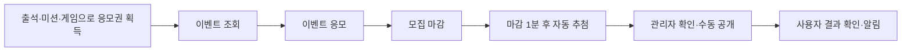

기본 이벤트는 `NO_TICKET`(응모권 미사용), 겟또타임은 `TICKET`(응모권 사용)입니다. 사용자 멤버십 `excellent/vip/vvip`와 응모권 등급 `BRONZE/SILVER/GOLD/PLATINUM`은 서로 다른 개념입니다.

사전 등록된 가상 사용자를 선택하는 시연 환경으로, 사용자 문맥은 `X-User-*` 헤더를 DB와 대조합니다. 별도 회원가입·로그인 토큰 발급과 실제 외부 문자·이메일·푸시 발송은 제공하지 않습니다. 구현·제외 범위는 [공용 범위](https://github.com/Uplus-GETDDO/getddo-spec/blob/main/00-requirements/scope.md)를 따릅니다.

## 기술 스택

| 구분 | 기술 |
| --- | --- |
| 언어 |  |
| 프레임워크 |   |
| 빌드 |  |
| 데이터베이스 |  |
| 요청 제한 저장소 |  |
| 영속성·마이그레이션 |    |
| 객체 매핑 |   |
| API 문서 |   |
| 테스트 |    |
| 실행 환경 |   |
| 이미지 저장·배포 | AWS S3 · CloudFront · ECR · EC2 · ALB · RDS · ElastiCache · Systems Manager · Parameter Store |
| 관측 | CloudWatch Logs·앱 지표 · Prometheus · Grafana 연계 |
| CI/CD |  OIDC · SSM 순차 배포·복구 |

## 주요 고민과 결론

| 해결할 문제 | 적용한 방식 | 확인할 근거 |
| --- | --- | --- |
| HTTP·업무·외부 저장소의 결합 | 다섯 모듈로 책임을 나누고 `core`의 계약을 DB·S3·Redis가 구현 | [모듈 의존 관계](#모듈-의존-관계) |
| 재전송·동시 요청의 중복 지급·초과 차감 | 요청 ID·행 잠금·고정 잠금 순서·DB 유일 제약, 접수와 차감의 같은 트랜잭션 | [정합성 검증](#정합성-검증) |
| 마감·취소와 응모의 경합 | 마감 세 번 확인, 이벤트 잠금, 원본 응모권 반환과 상태 변경의 원자성 | [정합성 검증](#정합성-검증) |
| 추첨 근거와 공개 결과의 불일치 | 후보·조건·가중치 스냅샷, 불변 확정 결과, 관리자 수동 공개 버전 | [추첨 구조](https://github.com/Uplus-GETDDO/getddo-be/wiki/Mentoring-Drawing-Sequences) |
| 서버별 요청 제한·중간 실패한 작업 | Redis 공유 제한·Lua 차단, DB 작업·진행 위치·임대 기반 재시도 | [비동기 작업 런북](docs/06-runbook/README.md) |
| 교체 배포와 연결 장애 | 검증한 이미지의 순차 교체·복구, DB 연결 장애 503 구분과 같은 키 재시도 | [배포·연결 복구](docs/06-runbook/database-connection-recovery.md) |

## 기술 선택 근거

| 선택 | 왜 이걸 골랐나 |
| --- | --- |
| Spring Boot · Spring Data JPA | 업무 규칙(`core`)과 저장 구현(`storage:db`)을 나누고, 변경은 도메인 객체와 Entity를 Mapper로 변환해 처리 |
| MySQL 8.4 · Flyway | 모든 스키마 변경을 Flyway 마이그레이션으로만 반영해 환경마다 스키마가 달라지지 않게 한다. 기존 마이그레이션은 수정하지 않고 새 파일을 추가한다 |
| Redis · Lua | 서버가 여러 대여도 요청 횟수를 한곳에서 센다. 응모 자동 차단·저장 대기를 원자 평가하고, 차단 이력은 별도 작업자가 MySQL로 옮긴다 |
| S3 · CloudFront | 이벤트 썸네일·상세 안내·경품의 파일 저장과 공개 URL을 분리한다. DB에는 이미지 키를 보관한다(`storage:s3`) |
| Testcontainers | 개발용 DB 설정 없이 임시 MySQL 8.4·Redis에서 저장·잠금·마이그레이션·Lua를 검증한다. S3 연동 테스트는 S3Mock을 사용한다 |
| Docker · GitHub Actions · SSM | 한 번 만든 이미지를 CI에서 검증하고 같은 이미지를 배포한다. 정기 릴리스와 버전 발행까지 자동화한다 |

## 백엔드 팀 구성 및 역할

이 저장소의 백엔드 팀원 5명만 소개합니다.

### 팀원 소개와 담당 영역

- **이경주** — 인프라·공통 기반·사용자: 실행·배포 환경, 공통 응답·오류·시간·감사 기록, 사용자·역할·멤버십
- **석종수** — 어뷰징 차단 기록·추첨: 응모 요청 반복 초과 자동 차단·이력 저장·조회, 후보·가중치 스냅샷, 추첨·당첨 취소·재추첨·결과 공개
- **전민규** — 백오피스·알림·게임: 관리자 운영 기능, 배너·정책 관리, 알림 생성·발송·복구, 게임 검증·보상 자격
- **윤태형** — 응모권·미션·출석·응모: 응모권 지급·차감·반환·만료, 출석·미션 보상, 응모 접수·내역, 요청 빈도 제한, 플래티넘 등급
- **박지훈** — 이벤트·경품 관리·이벤트 취소: 사용자·관리자 이벤트 조회, 이벤트·경품 CRUD, S3 이미지 업로드, 시작·마감 전환, 취소 연동

## 아키텍처

### 시스템 아키텍처

[](docs/assets/cloud-architecture.png)

### 모듈 의존 관계

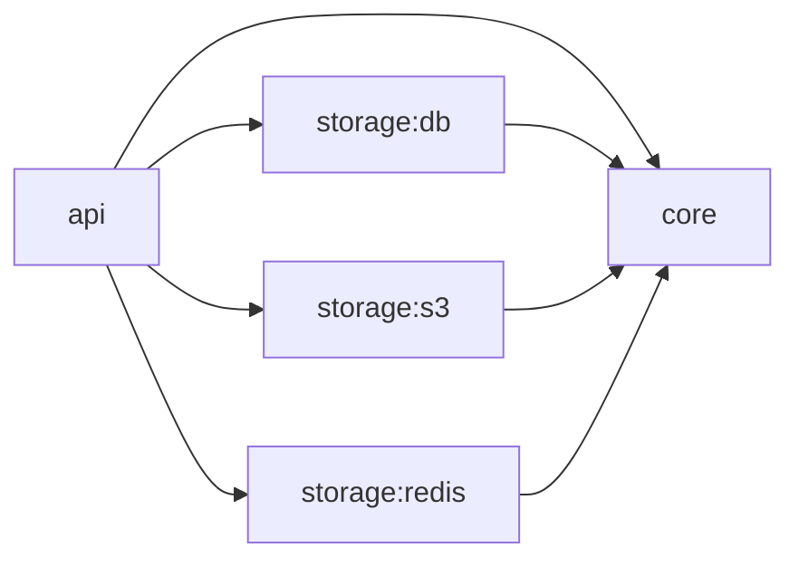

`api`만 실행 가능한 Spring Boot JAR을 만들고, `core`·`storage:db`·`storage:s3`·`storage:redis`는 라이브러리로 함께 실행합니다. `core`는 HTTP DTO와 JPA Entity에 의존하지 않고 Repository 인터페이스로 저장 기능을 사용합니다.

| 모듈 | 역할·사용 이유 |
| --- | --- |
| api | HTTP 요청·입력 검증·사용자 문맥·응답 변환을 업무 규칙과 분리 |
| core | 도메인 모델·업무 규칙·Service·트랜잭션과 Repository 계약을 관리 |
| storage:db | JPA·JDBC 저장 구현, Entity·Mapper와 Flyway 마이그레이션을 관리 |
| storage:s3 | 이벤트·경품 이미지의 S3 저장과 AWS SDK 설정을 업무 규칙에서 분리 |
| storage:redis | 요청 제한·응모 차단의 Redis 접근, 연결 풀과 Lua 실행을 HTTP 처리에서 분리 |

### 요청 흐름과 컴포넌트 책임

| 단계 | 책임 |
| --- | --- |
| HTTP 진입 | Controller·DTO가 입력을 해석하고 공통 사용자 문맥을 DB 정보와 대조 |
| 업무 처리 | `core` Service가 자격·상태·시간 조건과 트랜잭션 경계를 결정 |
| 저장·조회 | `storage:db`의 JPA·JDBC가 행 잠금·제약·일괄 조회와 Flyway 스키마를 사용 |
| 요청 제한·차단 | `storage:redis`가 서버 공통 요청 횟수·응모 자동 차단·저널을 처리 |
| 이미지 | BE 업로드 → S3 저장 → DB 이미지 키 보관 → CloudFront 공개 URL 제공 |
| 비동기 작업 | 모집 상태·추첨·알림·만료·차단 이력 작업자가 대상 선점·재시도·진행 위치를 관리 |

Redis는 요청 제한·차단용이며 응모권 잔액이나 추첨 결과의 원본 저장소가 아닙니다. 응모권·접수·확정 결과의 원본은 MySQL에 보관합니다. 세부 업무 흐름·테스트 결과는 [프로젝트 수행 경과](#프로젝트-수행-경과)의 도메인별 토글에서 이어집니다.

### 패키지 구조

`<도메인>`은 `user`, `event`, `ticket` 등 기능별 패키지를 뜻합니다.

```text
getddo-be/
├── api/                                         # HTTP 요청·응답과 애플리케이션 실행
│   ├── build.gradle                             # 웹·검증·API 문서 의존성
│   └── src/
│       ├── main/
│       │   ├── java/com/getddo/api/
│       │   │   ├── GetddoBeApplication.java     # Spring Boot 진입점
│       │   │   ├── common/                      # API 공통 처리
│       │   │   │   ├── config/                  # MVC·CORS·OpenAPI 설정
│       │   │   │   ├── context/                 # 사용자 문맥 어노테이션·ArgumentResolver
│       │   │   │   ├── exception/               # 공통 API 오류 코드·전역 예외 처리
│       │   │   │   ├── ratelimit/               # 요청 제한·응모 차단 인터셉터와 설정
│       │   │   │   └── response/                # 공통 응답 형식 ResponseEnvelope
│       │   │   └── <도메인>/
│       │   │       ├── controller/              # 요청을 받아 Service에 위임
│       │   │       ├── dto/request/             # 요청 DTO와 입력 검증
│       │   │       └── dto/response/            # 응답 DTO·from(domain) 변환
│       │   └── resources/                       # application.yaml 등 실행 설정
│       ├── test/                                # DB 없는 API·설정 테스트
│       └── integrationTest/                     # 앱 기동·API·DB 연동 테스트
├── core/                                        # 도메인 모델과 비즈니스 규칙
│   ├── build.gradle                             # Spring Context·트랜잭션 의존성
│   └── src/
│       ├── main/java/com/getddo/core/
│       │   ├── common/                          # 공통 예외·페이지 조회 모델·시각 처리
│       │   └── <도메인>/
│       │       ├── domain/                      # 도메인 객체·상태·비즈니스 규칙
│       │       ├── service/                     # 업무 흐름과 트랜잭션
│       │       ├── repository/                  # 조회·저장 인터페이스
│       │       └── exception/                   # 도메인 오류 코드(ErrorCode 구현)
│       └── test/                                # 도메인 규칙·Service 테스트
├── storage/                                     # 저장소 구현 모듈의 경로 구분
│   ├── redis/                                   # Redis 제한기·Lua·연결 풀 및 Redis 전용 테스트
│   ├── s3/                                      # 이벤트·경품 이미지 S3 저장 어댑터
│   │   ├── build.gradle                         # AWS SDK 의존성
│   │   └── src/main/java/com/getddo/s3/event/    # S3 클라이언트 설정·저장 구현
│   └── db/                                      # MySQL 영속성 구현
│       ├── build.gradle                         # JPA·Flyway·MySQL 드라이버 의존성
│       └── src/
│           ├── main/
│           │   ├── java/com/getddo/db/
│           │   │   ├── common/                  # 공통 Entity·JPA Auditing 설정
│           │   │   └── <도메인>/
│           │   │       ├── entity/              # DB 테이블에 대응하는 JPA Entity
│           │   │       ├── repository/          # JpaRepository·core Repository 구현
│           │   │       └── mapper/              # Entity ↔ 도메인 객체 변환
│           │   └── resources/db/migration/      # 도메인별 Flyway SQL
│           ├── test/                            # DB 없는 영속성 관련 테스트
│           ├── integrationTest/                 # 실제 MySQL·마이그레이션 검증
│           └── testFixtures/                    # 공유 Testcontainers 설정
├── .github/                                     # GitHub 협업·자동화 설정
│   ├── pull_request_template.md                 # PR 작성 양식
│   └── workflows/                               # 빌드·테스트·이미지 생성·CD·PR 제목 검사
├── infra/                                       # 인프라 정의·배포 자동화 (Gradle 모듈과 별도)
│   └── scripts/                                 # 서버 배포·설정 조회 스크립트
│       ├── deploy-ssm.py                         # 배포 파일 전달·SSM 순차 교체·결과 확인
│       ├── deploy-container.sh                   # 설정·컨테이너 교체와 실패 복구
│       ├── publish-image.py                      # main 이미지의 ECR 게시
│       ├── prepare-image.py                      # 후보·복구 이미지 사전 준비·검증
│       ├── deploy-staging.py                     # 검증한 PR 이미지의 스테이징 배포
│       ├── fetch-app-env.py                      # Parameter Store 설정 조회·검증
│       ├── daily-release.py                      # dev CI 확인·main 병합
│       └── publish-release.py                    # 배포 성공 버전 발행
├── docs/                                        # 백엔드 API·DB·결정·작업 기록
├── gradle/wrapper/                              # Gradle 실행 버전 고정
├── compose.yaml                                 # 로컬 앱·MySQL (기본 요청 제한은 memory)
├── compose.deploy.yaml                          # 서버용 앱 컨테이너 구성
├── Dockerfile                                   # 애플리케이션 이미지 빌드
├── .env.example                                 # 로컬 환경변수 예시
├── build.gradle                                 # 모듈 공통 빌드·테스트 설정
├── settings.gradle                              # 프로젝트 이름·모듈 등록
├── gradlew                                      # macOS·Linux·WSL Gradle 실행
└── gradlew.bat                                  # Windows Gradle 실행
```

## ERD

[](docs/assets/erd-2026-10-23.png)

[ERDCloud에서 확대·이동하며 보기](https://www.erdcloud.com/d/vuDvgmGQcvHf6f6g9) · [원본 이미지](docs/assets/erd-2026-10-23.png)

이미지는 2026-10-23의 설계 스냅샷입니다. 이후 인덱스 변경을 포함한 현재 DB 정의는 [DBML](docs/03-database/schema.dbml)과 [Flyway SQL](storage/db/src/main/resources/db/migration/)을 기준으로 확인합니다. 아래는 DBML의 46개 테이블을 분류한 것이며, 배너 순서 변경을 직렬화하는 내부 잠금 테이블도 포함합니다.

### 도메인별 ERD

| 도메인 | 테이블 수 | 내용 |
| --- | ---: | --- |
| [사용자](https://github.com/Uplus-GETDDO/getddo-be/wiki/ERD-user) | 1 | 사용자 정보·역할·멤버십 |
| [이벤트·응모](https://github.com/Uplus-GETDDO/getddo-be/wiki/ERD-event) | 6 | 이벤트·경품·응모자·응모 요청·배너·배너 카탈로그 잠금 |
| [출석](https://github.com/Uplus-GETDDO/getddo-be/wiki/ERD-attendance) | 5 | 일일·연속 출석과 보상 청구 |
| [미션](https://github.com/Uplus-GETDDO/getddo-be/wiki/ERD-mission) | 10 | 퀴즈·설문·제출·보상 청구 |
| [게임](https://github.com/Uplus-GETDDO/getddo-be/wiki/ERD-game) | 6 | 게임·플레이·통계·보상·플레이 검증 근거 |
| [보상 정책](https://github.com/Uplus-GETDDO/getddo-be/wiki/ERD-reward) | 1 | 출석·미션·게임 보상 정책과 적용 기간 |
| [응모권](https://github.com/Uplus-GETDDO/getddo-be/wiki/ERD-ticket) | 2 | 응모권 한 장의 현재 상태와 처리 이력 |
| [어뷰징 차단 이력](https://github.com/Uplus-GETDDO/getddo-be/wiki/ERD-abuse) | 1 | 응모 자동 일시 차단의 시작·종료 시각과 판정 근거 |
| [추첨·발표](https://github.com/Uplus-GETDDO/getddo-be/wiki/ERD-drawing) | 11 | 추첨 실행·후보·결과·확인·공개 버전과 실패 이력 |
| [알림](https://github.com/Uplus-GETDDO/getddo-be/wiki/ERD-notification) | 2 | 알림 생성 작업과 사용자 알림 |
| [감사 로그](https://github.com/Uplus-GETDDO/getddo-be/wiki/ERD-audit) | 1 | 변경 행위와 변경 전후 데이터 |

## 정합성 검증

이 프로젝트의 과제 원문은 응모권을 "포인트·응모권처럼 돈에 준해 다뤄야 하는 데이터"로 보고 **정합성**을 요구합니다. 아래는 그 요구를 어떻게 풀었는지를 **원문 요구 → 깨질 수 있는 곳 → 어떻게 막았나 → 어떻게 시험했나** 순서로 정리한 것입니다. 발표자료는 이 흐름의 요약이고, 이 README는 설계와 결과를, [Wiki](https://github.com/Uplus-GETDDO/getddo-be/wiki/Consistency-Verification)는 시험별 기록을 담습니다.

### 1. 과제 원문이 요구한 정합성

| 요구 | 과제 원문 |
| --- | --- |
| ① 중복 반영 금지 | "버튼 연타, 새로고침, 동시 요청, 날짜가 바뀌는 순간의 요청 등 어떤 상황에도 같은 적립/응모가 중복 반영되어서는 안 된다." 무엇을 "같은 행위"로 볼지(중복 판정 기준)는 팀이 규칙으로 정의한다. |
| ② 이력과 보유 수의 일치 | "응모권의 적립과 사용은 기존 기록을 수정·삭제하지 않는 이력으로 남기며, 이력의 합계와 현재 보유 응모권 수가 항상 일치해야 한다." |
| ③ 마감 기준 명단 | "추첨 대상 명단은 마감 시각 기준으로 확정하며, 마감 직전의 응모도 누락이나 이중 포함 없이 반영되어야 한다." |
| ④ 명단·조건 보존과 사후 검증 | "추첨에 사용한 응모자 명단과 조건을 보존하고, 같은 명단과 조건으로 다시 추첨하면 같은 결과가 재현되어야 한다 (추첨 과정의 재현·사후 검증 가능성)" |

④의 "재현"은 난수를 다시 돌려 같은 당첨자를 만드는 것이 아니라, 저장해 둔 후보·가중치·결과로 결과를 검증하는 것으로 해석했습니다(공용 명세 `drawing.md`가 AD04를 이렇게 정의합니다). 팀이 더한 요구는 **서버가 두 대여도 결과가 하나로 맞는 것**과 **실패 뒤 복구**입니다.

### 2. 깨질 수 있는 곳

요구를 보고 정합성이 깨질 수 있는 곳을 먼저 찾았습니다. 번호는 아래 모든 표에서 같습니다.

| # | 깨질 곳 | 어떤 사고가 나는가 | 요구 |
| --- | --- | --- | --- |
| 1 | 재전송·연타·새로고침 | 같은 응모가 두 번 접수된다 | ① |
| 2 | 동시 요청이 보유량·상한을 넘김 | 3장 보유자가 5건을 동시에 보내 3장을 넘는 응모가 접수된다 | ① |
| 3 | 같은 보상(출석·미션·게임)의 중복 지급 | 같은 날 출석을 여러 번 눌러 보상이 두 번 지급된다. 날짜 경계에서도 | ① |
| 4 | 이력 합계 ≠ 보유 수 | 이력에는 차감이 남았는데 보유 수는 그대로이거나 그 반대 | ② |
| 5 | 처리 도중 실패 | 응모권은 차감됐는데 응모 기록이 없거나, 응모만 남고 차감이 없다 | ①② |
| 6 | 마감 직전 응모의 누락·중복 | 마감 직전에 접수된 응모가 후보에서 빠지거나 두 번 들어간다 | ③ |
| 7 | 마감 뒤 접수가 후보에 포함 | 접수 시각이 마감 이후인 응모가 추첨 대상이 된다 | ③ |
| 8 | 확정 뒤 명단·조건의 변경 | 추첨 뒤에 후보·가중치·경품 조건이 달라진다 | ④ |
| 9 | 결과를 사후에 검증할 수 없음 | 명단·조건이 남아 있지 않아 결과를 확인할 수 없다 | ④ |
| 10 | 이벤트 취소와 신규 응모의 경쟁 | 취소 뒤 응모가 접수되거나 반환이 빠진다 | ② |
| 11 | 운영자의 동시 작업 | 관리자 둘이 같은 이벤트를 동시에 취소한다 | ① |
| 12 | 월말 만료 경계 | 정각의 만료와 사용이 겹친다 | ② |
| 13 | 서버 여러 대 | 서버마다 따로 세어 한도가 늘어난다. 예약 작업이 두 번 돈다 | 팀 요구 |

9번까지가 원문 요구에서 곧바로 나온 곳이고, 10~13번은 구현을 보며 더한 곳입니다.

### 3. 어떻게 막았나

#### 3-1. "같은 행위"를 이렇게 정의했습니다

원문이 팀에 맡긴 중복 판정 기준입니다. 모두 DB의 기본 키 또는 유일 제약으로 구현했습니다.

| 행위 | 같은 행위의 기준 | 같은 요청이 다시 오면 |
| --- | --- | --- |
| 응모 | 요청 ID(`Idempotency-Key`, UUID)가 응모의 기본 키 | 새로 응모하지 않고 처음 결과를 돌려줍니다. 같은 ID에 다른 내용이면 `409 ENTRY-009` |
| 출석 | (사용자, KST 날짜) | 같은 날 두 번째 출석은 새 행이 만들어지지 않습니다 |
| 미션 보상 | (사용자, 미션) | 완료·보상 청구가 한 번만 만들어집니다 |
| 게임 보상 | (사용자, 게임, KST 날짜) | 하루 한 번만 보상이 청구됩니다 |

#### 3-2. 응모 한 건은 한 트랜잭션에서 처리합니다 (깨질 곳 1·2·5)

1. 응모 요청이 오면 이벤트 행을 **공유 잠금**으로 읽고 마감을 1차 확인합니다.
2. **참여자 행을 잠가** 같은 사용자의 요청을 직렬화하고 누적 상한을 확인합니다.
3. 응모 행을 저장합니다(응모 ID가 기본 키라, 같은 ID가 동시에 와도 하나만 남습니다).
4. 응모권을 차감합니다. 등급은 정해진 순서로, 같은 등급 안에서는 만료가 빠른 응모권부터 **한 장씩 잠가** 같은 사용자의 동시 차감이 서로 기다릴 뿐 교착하지 않게 했습니다. 후보 응모권은 범위에 `FOR UPDATE`를 걸지 않고 읽어서 gap lock이 생기지 않게 했고, 그래서 `READ_COMMITTED`가 전제입니다.
5. 마감을 2차로 확인하고, 커밋 직전에 한 번 더 확인합니다.
6. 마감 전이면 응모·차감·이력을 **함께 커밋**하고, 마감을 넘었으면 모두 **롤백**합니다(`ENTRY-005`).

차감 서비스는 호출자의 트랜잭션에 참여하며(`MANDATORY`) 예외를 삼키지 않습니다. 삼키면 "응모는 있는데 차감은 없는" 상태가 생기기 때문입니다. 거절 기록은 응모가 롤백된 뒤 별도 트랜잭션에 남깁니다. 흐름도는 `프로젝트 수행 경과 > 응모권`의 "응모권 트랜잭션"에 있습니다.

#### 3-3. 이력은 지우지 않고 쌓습니다 (깨질 곳 4·10)

- 응모권 한 장이 한 행이고, 상태가 바뀔 때마다 이력을 **추가만** 합니다(수정·삭제 없음). "현재 상태와 마지막 이력의 일치"를 검사합니다.
- 이벤트 취소 시 반환은 원본 사용 이력과 연결해 **같은 응모권을 원래 등급 그대로** 한 번만 돌려줍니다. 취소와 반환은 한 트랜잭션입니다.

#### 3-4. 마감은 서버가 판정하고 세 번 확인합니다 (깨질 곳 6·7)

- 마감은 클라이언트가 아니라 서버 시각으로 판정합니다. 응모 처리 중 처리 시작, 차감 뒤, 커밋 직전의 세 번 확인합니다.
- **접수 시각**은 서버가 응모 처리를 시작한 시각이며 DB 커밋 시각이 아닙니다.
- 마지막 확인과 실제 커밋 사이의 짧은 틈은 DB가 커밋 시각을 미리 알려 주지 않아 없앨 수 없습니다. 그 틈에 커밋된 응모는 마감 전 접수로 인정하는 규칙을 공용 명세에 예외(GD-205)로 승인받았습니다.

#### 3-5. 추첨 후보와 조건을 저장하고 저장된 값으로 검증합니다 (깨질 곳 6~9)

- 마감 전에 접수된 응모만 후보에 넣고, 접수 시각이 마감 뒤인 응모는 뺍니다. 추첨 준비는 이벤트를 잠근 뒤 실행해 후보와 응모 기록이 어긋나지 않게 합니다.
- 후보·가중치·경품 조건을 추첨 실행마다 저장하고, 확정된 뒤에는 바꾸지 않습니다. 같은 실행을 다시 요청하면 저장된 결과를 돌려줍니다.
- 사후에는 저장된 후보·가중치·결과를 서로 대조하는 검증(AD04)으로 확인하며, 결과는 `draw_checks`에 남습니다. 난수를 다시 돌리는 검증이 아닙니다.
- 추첨 구현은 석종수 님 담당입니다. 자세한 흐름은 `프로젝트 수행 경과 > 추첨·결과 공개`를 참고하세요.

### 4. 규칙과 시험 방법

요구를 DB로 검사할 수 있도록 **규칙(불변식) 10개**로 풀었습니다(원문에서 8개, 팀 규칙·구현 요구 2개).

| 규칙 | 내용 | 깨질 곳 | 근거 |
| --- | --- | --- | --- |
| I1 상태와 이력 일치 | 응모권의 현재 상태·버전과 마지막 이력이 일치한다 | 4 | 원문: 이력 합계 = 보유 수 |
| I2 초과·이중 사용 금지 | 보유한 응모권보다 많이 쓰거나, 한 장을 반환 없이 두 번 쓸 수 없다 | 2 | 원문: 중복 반영 금지 |
| I3 보상은 1회 | 같은 보상 근거(출석일·미션·게임)는 지급 1회 | 3 | 원문: 같은 적립 중복 금지 |
| I4 차감 = 사용 이력 | 접수된 응모의 차감 장수 = 사용 이력 수, 거절된 응모에는 사용 이력이 없다, 취소로 반환된 응모는 사용과 반환이 쌍이다 | 4·10 | 원문: 적립·사용은 이력으로 남김 |
| I5 이력은 정확히 1행 | 상태가 바뀔 때마다 이력이 정확히 1행 | 4 | 원문: 수정·삭제 없는 이력 |
| I6 만료 뒤 사용 금지 | 만료 시각 이후에는 사용 이력이 없다 | 12 | 팀 규칙 |
| I7 재시도는 1번 | 같은 요청 ID를 재시도해도 효과는 1번 | 1 | 원문: 연타·새로고침·동시 요청 |
| I8 접수와 차감은 함께 | 응모 접수와 응모권 차감은 함께 성공하거나 함께 실패한다 | 5 | 구현 요구 |
| I9 마감 기준 후보 | 추첨 후보는 마감 전에 접수된 응모와 정확히 같다 | 6·7 | 원문: 마감 시각 기준 명단 |
| I10 추첨 근거 보존·검증 | 추첨 후보·조건·가중치·확정 결과를 보존하고 저장된 값의 정합성을 검증한다. 난수를 다시 실행해 같은 당첨자를 뽑는 의미가 아니다 | 8·9 | 원문: 명단·조건 보존, 사후 검증 |

시험은 네 층으로 했습니다.

1. **규칙 SQL 검사**: I1~I8은 시험 뒤마다 SQL로 위반 건수를 셌고, I9·I10은 스테이징에 남은 시험 데이터에 SQL을 돌려 확인했습니다.
2. **동시 요청 통합 테스트**: 로컬 Testcontainers(MySQL 8.4)에서 같은 요청·동시 요청·날짜 경계를 반복했습니다.
3. **보호 장치를 하나씩 빼 보기**: 로컬에서 DB 제약을 풀거나 잠금을 바꿔 봤고, 7종 중 6종에서 위반이 나타났습니다. 나타나지 않은 1종(출석 `attendances` 유일 제약만 뺀 경우)은 다른 장치(보상 청구 유일 제약)가 막은 것입니다.
4. **스테이징 서버 2대 실측**: API 서버 2대(ALB 뒤)에서 10/24~26에 응모 폭주, 중복 요청, 취소·반환, 자정 출석, 추첨 후보를 시험했습니다.

### 5. 시험 결과

환경 표기: ✅ 확인함, — 하지 않음. 로컬은 10/20 Testcontainers, 서버는 스테이징 API 2대(10/24~26)입니다.

| # | 깨질 곳 | 로컬 | 서버 | 남은 것 |
| --- | --- | --- | --- | --- |
| 1 | 재전송·연타·새로고침 | ✅ 같은 키 100회 재전송에 응모 1건 | ✅ 같은 키 동시 5건에도 행 1개(10명 전원), 다른 내용은 409 | 월 경계·장애 주입 |
| 2 | 동시 요청의 보유량·상한 초과 | ✅ 상한 5장 경쟁 위반 0 | ✅ 3장 보유 60명 전원 정확히 3건 | |
| 3 | 같은 보상 중복 지급 | ✅ 출석 3중복·미션 4중복 | ✅ 자정 출석 연타 1,000건에서 출석 = 청구 = 응모권 246, 게임 205건 중복 0. 미션은 "시험 3" 참고 | 월 경계 |
| 4 | 이력 합계 ≠ 보유 수 | ✅ 규칙 I1~I8 위반 0(960건 × 16회) | ✅ 전체 장부 14항목 위반 0(응모권 540,240장, 팀 부하 시험 데이터 포함) | 등급·응모권 ID 단위 대조는 하지 않음 |
| 5 | 처리 도중 실패 | ✅ 도중 실패 시 응모·차감 함께 롤백 | — | 서버에서 장애를 일으킬 수단이 없음 |
| 6 | 마감 직전 응모의 누락·중복 | — | ✅ 접수 1,522건에서 후보 = 접수 응모(이벤트 6개) | 마감 창을 더 좁힌 시험, 커밋 직전 롤백의 직접 관측 |
| 7 | 마감 뒤 접수가 후보에 포함 | — | ✅ 접수 시각 기준 마감 뒤 접수 0건 | |
| 8 | 확정 뒤 명단·조건의 변경 | — | ✅ 규칙 스냅샷 가중치 1·3·5·10 저장, 자동 추첨 1건 | 확정 뒤 변경 시도는 직접 시험하지 않음 |
| 9 | 결과를 사후에 검증할 수 없음 | — | ✅ AD04 1건 `passed: true`, 검사 5개 일치 | 불일치 응답·반복 호출은 보지 못함 |
| 10 | 이벤트 취소와 신규 응모 | ✅ 취소 중 동시 응모 | ✅ 응모 60명 중 취소를 동시에 보낸 시험 2회에서 수락 응모마다 차감 1·반환 1 | 취소·마감의 정확한 순간 경쟁(서버 요청 로그 없음) |
| 11 | 운영자의 동시 작업 | ✅ 관리자 2명 동시 취소 | ✅ 200 한 건, 409 `EVENT-017` 한 건 | 추첨 버튼 동시 클릭 |
| 12 | 월말 만료 경계 | ✅ 정각 만료·직전 미만료 | — | 시간 제어가 필요해 서버에서 불가 |
| 13 | 서버 여러 대 | ✅ 앱 2개(한 JVM) 위반 0 | ✅ 분산 49.8 : 50.2, 11번째부터 429, 예약 작업 중복 0 | 서버 시계 20ms대 차이 |
| — | 재시작·롤링 배포 중 중복·누락 | — | — | 미검증 |

아래는 시험별 상세 기록입니다. 시험 날짜, 조건, 기대값과 실제 결과를 모두 적었습니다.

#### 시험 1. 마감 직전 응모 폭주

- **가정한 상황**: 마감 직전에 응모가 몰린다. 사용자 200명이 마감 10초 전부터 5초 후까지 응모 5건씩, 3회(접수 1,522건)
- **환경**: 스테이징 서버(API 2대)
- **확인할 것**: 이런 상황에서도 접수 시각이 마감 뒤인 응모가 없고, 접수·차감·이력과 추첨 후보가 맞는지

| 확인 항목 | 기대 | 결과 |
| --- | --- | --- |
| 접수 시각이 마감 이후인 응모 | 0건 | 0건 (3회 모두, 전체 이벤트에서도 0건) |
| 접수 응모 = 차감 장수 = 사용 이력 | 같은 값 | 같은 값 (510 / 486 / 526) |
| 추첨 후보와 접수 응모의 차이 | 0명 | 0명 |
| 추첨 후보의 응모 ID 집합과 접수 응모 ID 집합의 차이 | 0건 | 0건 (이벤트 6개 모두) |
| 예상 밖 서버 오류(5xx) | 0건 | 0건 |

접수 시각은 서버가 응모 처리를 시작한 시각이며 DB 커밋 시각이 아닙니다. 커밋 직전 확인과 커밋 사이의 짧은 틈은 공용 명세에서 예외로 인정했고, 이 시험이 말하는 것은 "접수 시각이 마감 뒤인 응모 0건"입니다. 마지막 접수는 매번 마감 21~24ms 전이었으며 보장 수치가 아니라 측정값입니다.

#### 시험 2. 같은 사용자의 연타·동시 요청

- **가정한 상황**: 한 사용자가 응모 버튼을 연타하거나 같은 요청을 다시 보낸다. 100명이 응모 5건씩 동시에 전송, 같은 키 재전송과 다른 내용 전송
- **환경**: 로컬(같은 키 100회 재전송, 응모권 3장에 8요청 동시), 스테이징 서버
- **확인할 것**: 보유량보다 많이 응모되거나 같은 요청이 두 번 반영되지 않는지

| 확인 항목 | 기대 | 결과 |
| --- | --- | --- |
| 응모권 3장 사용자 60명의 접수 건수 | 사용자마다 3건 | 전원 3건 |
| 응모권 1장 사용자 30명의 접수 건수 | 사용자마다 1건 | 전원 1건 |
| 같은 키로 5건 보낸 10명의 응모 행 수 | 사용자마다 1개 | 전원 1개 |
| 접수 = 차감 = 사용 이력 | 같은 값 | 220 = 220 = 220 |
| 같은 키에 다른 내용을 보낸 4건 | 4건 모두 409 거절 | 4건 모두 409 |
| 같은 키 100회 재전송 (로컬) | 응모 1건, 차감 2장 | 응모 1건, 차감 2장 |

#### 시험 3. 서버 2대에서의 중복 방지

- **가정한 상황**: 서버가 두 대이고 요청이 두 서버로 나뉘어 들어온다. 같은 사용자의 반복 호출, 같은 미션의 동시 제출, 예약 작업이 두 서버에 걸쳐 일어난다.
- **환경**: 스테이징 서버(API 2대), 로컬(앱 2개)
- **확인할 것**: 서버가 둘이어도 한도·예약 작업·보상이 하나로 맞는지

| 확인 항목 | 기대 | 결과 |
| --- | --- | --- |
| 서버 a·c가 받은 요청의 비율 | 두 서버가 나눠 받음 | 49.8 : 50.2 |
| 같은 사용자 25번 호출에서 429가 시작되는 순서 | 11번째 | 11번째 (서버마다 따로 셌다면 20번대) |
| 이벤트 7개의 추첨 실행 | 이벤트마다 1건 | 이벤트마다 1건 |
| 이벤트 7개의 시작 알림 작업 | 이벤트마다 1건 | 이벤트마다 1건 |
| 미션 동시 제출의 보상 청구 | 청구가 생긴 사용자마다 1건, 2건 이상 0명 | 설문 100명은 전원 1건. 퀴즈는 100명 중 77명이 청구했고 모두 1건 (2건 이상 0명). 나머지 23명은 정답 기록만 남고 완료·청구가 없음 (원인 확인, GD-351로 수정해 PR #184 머지) |
| 수정 뒤 재시험 1차 (10/26 12:02, 300명·60초) | 5xx 0, 퀴즈 청구 100명 전원 1건 | 503 264건(DB 연결 풀 소진. 풀 크기 설정이 재배포 과정에서 빠져 기본값 10이 쓰임). 응답시간(성공+503 합침) 중앙값 3.0초·p95 4.7초. 퀴즈 청구 1건 64명·0건 36명, 청구 = 응모권 = 64, 정답 3행인데 청구 없는 사용자 0, 중복 0. 설문 82 = 82 |
| 수정 뒤 재시험 2차 (12:22) | 같음 | 503 61건(응답시간 중앙값 2.4초·p95 3.4초). 퀴즈 청구 1건 94명·0건 6명(94 = 94), 설문 100 = 100, 누락 패턴 0, 중복 0 |
| 503을 같은 제출 ID로 재시도한 3차 (12:42, 별도 시험) | 최종 실패 0, 전원 1건 | 첫 시도 503 17건이 모두 재시도에서 성공. 퀴즈 청구 100명 전원 1건, 청구 = 응모권 = 100, 설문 100 = 100, 중복 0. 실제 프론트가 같은 키로 재전송하는지는 확인하지 못함 |

#### 시험 4. 이벤트 취소·반환과 전체 장부

- **가정한 상황**: 관리자가 이벤트를 취소하고 응모권을 되돌려 준다. 관리자 둘이 동시에 취소하고, 시험이 끝난 뒤 전체 장부를 점검한다.
- **환경**: 로컬(취소 중 동시 응모 포함), 스테이징 서버
- **확인할 것**: 응모권이 원래 등급 그대로 한 번씩만 돌아오고, 이력 합계가 보유 수와 맞는지

| 확인 항목 | 기대 | 결과 |
| --- | --- | --- |
| 반환된 응모권 | 4장, 원래 등급 그대로 | 4장, 원래 등급 그대로 |
| 원본 사용 이력당 반환 이력 | 1건 | 1건 (사용 4 : 반환 4) |
| 관리자 둘의 동시 취소 | 한 요청만 성공 | 200 한 건, 409 한 건 |
| 응모 60명 중 취소를 동시에 보낸 시험 2회(10/26, 겹친 요청은 회당 15~16건): 수락 응모의 차감·반환 | 수락마다 차감 1건·반환 1건 | 26건·25건 모두 1:1 (누락·이중 반환 0) |
| 같은 시험의 거절 응모 | 차감 없음 | 34건·35건(409 `ENTRY-005`) 모두 차감 0 |
| 같은 시험의 취소 뒤 접수된 수락 응모 | 0건 | 0건 (응모 먼저·취소 먼저 둘 다 관측, 서버 요청 로그가 없어 정확한 도착 순서는 모름) |
| 전체 장부 점검 14항목의 위반 (응모권 54만 장, 팀 부하 시험 데이터 포함, 2회) | 0건 | 0건 |

#### 시험 5. 날짜가 바뀌는 순간의 출석 연타

- **가정한 상황**: 자정에 사용자가 몰려 출석 버튼을 연타한다. 사용자 200명이 KST 자정 전후 6초 안에 출석을 5번씩(1,000건)
- **환경**: 로컬(자정을 넘긴 재시도), 스테이징 서버(API 2대, 10/26 00:00)
- **확인할 것**: 자정 전후 요청이 맞는 날짜로 기록되고, 출석과 보상이 중복되지 않는지

| 확인 항목 | 기대 | 결과 |
| --- | --- | --- |
| 출석 날짜와 생성 시각(KST)의 날짜가 어긋난 행 | 0행 | 0행 (마지막 10/25 행 23:59:59.979, 첫 10/26 행 00:00:00.436) |
| 날짜별 출석 행 수와 사용자 수 | 같은 값 | 10/25: 107 = 107, 10/26: 139 = 139 |
| 출석 = 일일 보상 청구 = 응모권 수 | 같은 값 | 246 = 246 = 246 |
| 연속 출석 일수 | 이틀 출석은 2, 하루 출석은 1 | 46명은 2, 154명은 1 |

#### 시험 6. 추첨 후보·당첨자와 상한 (SQL)

- **가정한 상황**: 시험이 끝난 뒤 남은 데이터를 읽기 전용 SQL로 점검한다.
- **환경**: 스테이징 DB, SELECT만 실행 (10/26 00:13)
- **확인할 것**: 게임 일일 1회와 이벤트별 상한이 지켜지고, 추첨 후보와 당첨자가 규칙에 맞는지

| 확인 항목 | 기대 | 결과 |
| --- | --- | --- |
| 후보의 가중치 합 = 등급별 차감 장수 × 가중치 | 같은 값 | 후보 704명 모두 같은 값. 시험 응모권이 모두 브론즈라 브론즈 외 등급은 이 데이터로 확인하지 못함 |
| 등급을 섞은 응모의 후보 가중치 (10/26 12:54, 100명, 브론즈 149·실버 59·골드 19장, 플래티넘 0장) | 후보 가중치 = 차감 장수 × 1·3·5·10 | 후보 100명 불일치 0, 가중치 합 421 = 기대값, 규칙 스냅샷 가중치 1·3·5·10 일치, 차감 227 = 사용 이력 227, 자동 추첨 1건, 당첨 3 = 경품 3(후보 밖·중복 0). **플래티넘은 확인하지 못함**(정식 지급 경로가 없고 지급 확률이 0.02%). 응모는 순차라 동시 응모는 안 봄 |
| 사용자·게임·KST 날짜별 게임 보상 | 최대 1회 | 205건 중 같은 날 2건 이상 0 (DB 유일 제약이 막음) |
| 이벤트별 누적 사용 상한 | 상한 초과 0 | 상한 5장 이벤트 20개(122,088그룹) 초과 0, 최대 5장. 상한 없음 이벤트 7개는 명세가 월말 소진용으로 허용한 표현이라 제외 |
| 당첨자의 후보 밖 / 중복 당첨 / 경품별 인원 초과 | 모두 0건 | 당첨 304건에서 모두 0건 |

### 6. 한 것과 못 한 것

- 이번 관측에서 위반이 없었다는 뜻이며 결함이 없다는 증명은 아닙니다.
- **하지 못한 것**: 저장 도중 DB 장애·응답 유실·서버 종료 같은 장애 주입, 월 경계(10/31→11/1)와 월말 만료의 서버 시험, 서버 한 대 중단과 롤링 배포 중 요청, 서버 시계 차이의 정밀 측정, 취소·마감의 정확한 순간 경쟁(서버 요청 로그가 없어 "겹치도록 동시에 보내는" 시험까지만 함), 플래티넘 응모권으로 한 실제 추첨(정식 지급 경로가 없고 지급 확률이 0.02%라 시험 사용자에게 생기지 않음. 규칙 스냅샷의 가중치 10과 로컬 테스트로만 확인).
- 규칙 10개로는 잡히지 않은 결함이 시험에서 따로 발견됐습니다. 스테이징의 퀴즈 동시 제출에서 같은 사용자가 문항별로 동시에 제출하면 100명 중 23명이 정답 기록만 남고 보상을 받지 못했고, 일부 요청이 `400`·`500`으로 끝났습니다. 원인(같은 사용자의 요청을 직렬화하지 않아 완료 판정이 서로의 기록을 보지 못함)은 확인했고 GD-351(PR #184)로 수정해 머지했습니다. 수정 뒤 같은 부하(300명)로 스테이징에서 재시험한 결과 보상 누락과 중복은 0이었지만, DB 연결 풀(서버당 10개, 재배포 과정에서 설정이 빠져 기본값이 쓰임)이 차서 일부 요청이 503으로 거절돼 "실패 0" 기준은 충족하지 못했습니다(1차 264건, 2차 61건). 같은 제출 ID로 재시도한 별도 시험에서는 최종 실패 0, 퀴즈 100명 전원 보상 1건이었습니다. 수정이 연결 풀 압력을 키웠는지는 가르지 못했습니다. 위 503은 당시 앱별 풀 상한 10개 환경의 관측입니다. 이후 [PR #187](https://github.com/Uplus-GETDDO/getddo-be/pull/187)에서 배포 Compose가 앱별 최대 40개·최소 유휴 10개를 유지하도록 수정했습니다. 설정 변경을 위 시험의 재실행·성능 개선 결과로 해석하지 않습니다.
- AD04(저장된 후보·가중치·결과의 정합성 검증)는 한 건만 통과를 확인했습니다. 난수를 다시 돌려 같은 당첨자를 만드는 재현 검증은 포함되지 않았습니다.

시험별 상세는 [Wiki](https://github.com/Uplus-GETDDO/getddo-be/wiki/Consistency-Verification)에 있습니다.

## 프로젝트 수행 경과

아래는 2026-10-26까지 `dev`에 병합된 코드와 각 담당자의 PR·워크로그를 대조한 기능 설명입니다. 테스트 수와 성능 수치는 명시한 당시 환경·코드의 실행 기록이며 최신 전체 빌드나 운영 처리량을 뜻하지 않습니다.

<details>
<summary>인프라·CI/CD</summary>

<!-- 작성 담당: 이경주 -->

#### 요청·데이터 흐름

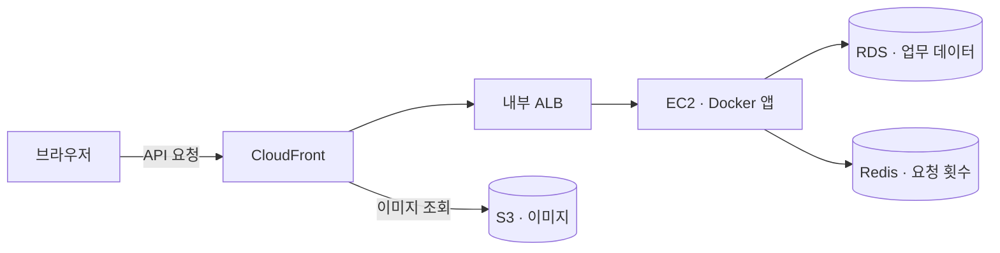

#### CI · 빌드와 이미지 생성

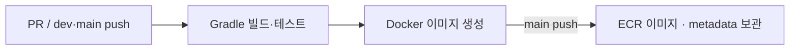

#### 정기 릴리스

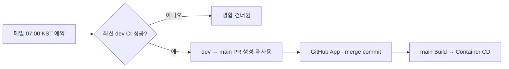

예약은 `DAILY_RELEASE_ENABLED` 등 선행 설정을 만족할 때 실행하며 GitHub 예약 지연과 CI·배포 시간이 있어 완료 시각을 보장하지 않습니다. [PR #134](https://github.com/Uplus-GETDDO/getddo-be/pull/134)에서 기존 08:00 예약을 07:00으로 변경했습니다.

#### CD · 검증한 이미지 배포

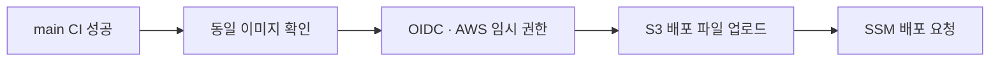

#### 서버 내부 · 설정 전달과 앱 교체

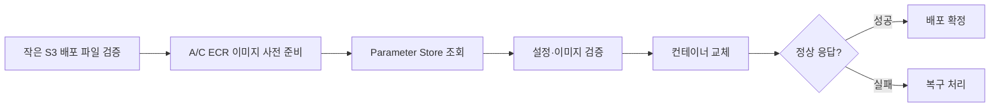

#### 배포 성공 후 버전 발행

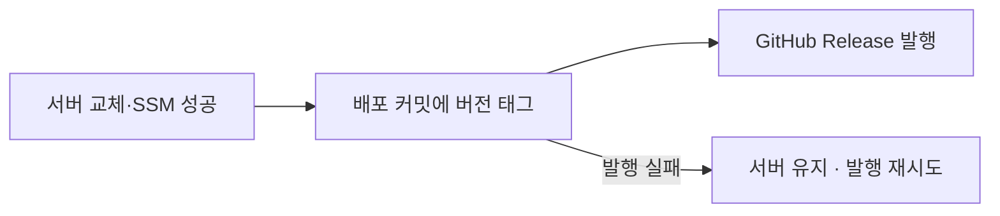

#### 실패 시 처리

| 실패 위치 | 처리 |
| --- | --- |
| dev·main CI | 정기 병합 또는 서버 배포를 진행하지 않음 |
| 설정 조회·이미지 검증 | 기존 앱·설정 유지 |
| 앱 교체·기동 확인 | 이전 설정·이미지 복구 시도 |
| 복구·기록 정리 | 백업·진행 기록 보존, 다음 배포 차단 후 수동 확인 |
| 태그·Release 발행 | 새 앱 유지, 서버를 롤백하지 않고 버전 발행 재시도 |

[배포 흐름·실패 대응 상세](https://github.com/Uplus-GETDDO/getddo-be/wiki/CI-CD-Release-Recovery)

#### 설계·기술 선택과 사용 이유

| 선택 | 정리할 내용 |
| --- | --- |
| Docker·Compose | CI 이미지 재사용·YAML 실행 설정 관리. Docker 운영과 서버별 배포 관리 부담을 수용. [대안·트레이드오프 비교](https://github.com/Uplus-GETDDO/getddo-be/wiki/Docker-Compose-Choice) |
| CloudFront·내부 ALB·보안 그룹 | HTTPS 진입, 요청 분산과 접근 경계 |
| RDS·ElastiCache·S3 | 업무 데이터·요청 횟수·이미지의 저장 목적 분리 |
| GitHub Actions·OIDC·SSM | 검증한 이미지 배포와 버전 발행을 분리합니다. 실패 단계별로 유지·복구·재시도를 구분합니다. [정기 릴리스·실패 대응](https://github.com/Uplus-GETDDO/getddo-be/wiki/CI-CD-Release-Recovery) |
| Parameter Store·IAM | 비밀값 보관과 서버별 접근 권한 |
| Terraform·IAM 정책 파일 | 리소스 정의와 변경 검토 방식 |

운영 `main`은 OIDC 게시자가 ECR에 올린 불변 이미지·metadata를 검증해 A/C 서버에 순차 적용합니다. PR·dev의 스테이징 경로는 CI 이미지 tar 검증을 유지합니다. 둘 다 후보와 이전 복구 이미지를 먼저 준비하고, 상대 서버 상태를 확인한 뒤 교체하며 결과가 불명확하면 다음 교체를 막습니다. 구현 근거는 [스테이징 PR #164](https://github.com/Uplus-GETDDO/getddo-be/pull/164) · [ECR 전환 PR #183](https://github.com/Uplus-GETDDO/getddo-be/pull/183)입니다.

CloudWatch 앱 지표와 별도 관리 포트의 Prometheus 계측으로 HTTP·Hikari·Tomcat·JVM 상태를 관측합니다. `/v3/api-docs`의 정상 응답은 DB 업무 성공을 보장하지 않습니다. 관리 포트의 접근 범위·배포 설정은 [계측 런북](docs/06-runbook/application-metrics.md)에서 확인합니다.

배포 코드: [CI](.github/workflows/build.yml) · [이미지 검증](.github/workflows/image.yml) · [ECR 게시](.github/workflows/image-publish.yml) · [ECR 배포·복구](docs/ecr-deployment.md) · [CD](.github/workflows/cd.yml) · [서버 배포](infra/scripts/deploy-container.sh) · [정기 릴리스](.github/workflows/daily-release.yml)

</details>

<details>
<summary>공통 기반</summary>

<!-- 작성 담당: 이경주 -->

#### 공통 JSON 응답

성공·실패 모두 `success`, `code`, `message`, `data`로 응답합니다. `data`에는 API별 응답 DTO를 담습니다.

```java
public record ResponseEnvelope<T>(boolean success, String code, String message, T data) {}
```

**성공 응답 · 내 정보 조회 예시**

```json
{
  "success": true,
  "code": "SUCCESS",
  "message": "성공했습니다.",
  "data": {
    "id": "019a0000-0000-7000-8000-000000000001",
    "name": "시연 사용자",
    "role": "USER",
    "status": "ACTIVE",
    "membership": "vip",
    "phoneNum": null,
    "email": null
  }
}
```

**실패 응답 · 미등록 사용자, HTTP 401**

```json
{
  "success": false,
  "code": "USER-002",
  "message": "사용자를 확인할 수 없습니다.",
  "data": null
}
```

데이터 없는 성공 응답은 `ResponseEnvelope.success(null)`을 사용합니다. 오류의 HTTP 상태는 응답 본문과 별도로 지정합니다.

#### 공통 예외 처리

각 도메인은 `ErrorCode`를 구현해 상태·코드·메시지를 정의하고, 업무 오류를 `BusinessException`으로 전달합니다.

```java
throw new BusinessException(UserErrorCode.USER_NOT_FOUND);
```

`GlobalExceptionHandler`가 정의된 HTTP 상태와 `ResponseEnvelope.fail()` 응답으로 변환합니다. Controller마다 try-catch를 반복하지 않으며, 예외 원문·스택 트레이스는 응답에 넣지 않습니다.

DB 연결 획득 실패·통신 단절은 `503 COMMON-007`로 구분합니다. 업무 오류·무결성 오류·교착을 모두 503으로 바꾸지 않으며, 응답 지연이나 503이 DB 미저장을 의미하지도 않습니다. 멱등 API는 기존 요청 ID·본문을 유지해 재조회·재시도합니다. 구현과 실제 MySQL 검증 기록은 [PR #176](https://github.com/Uplus-GETDDO/getddo-be/pull/176), 설정·한계·복구 절차는 [DB 연결 복구 런북](docs/06-runbook/database-connection-recovery.md)을 참고합니다.

#### 사용자 문맥과 Controller 재사용

```java
@GetMapping("/me")
public ResponseEnvelope<UserProfileResponse> getProfile(@CurrentUser User user) {
    return ResponseEnvelope.success(UserProfileResponse.from(userService.getProfile(user)));
}
```

`@CurrentUser`가 시연용 헤더의 형식과 DB 역할·멤버십을 대조해 사용자를 전달합니다. 같은 요청의 사용자 조회 결과를 재사용하고, 필요한 헤더는 Swagger에 자동 표시합니다.

#### 그 밖의 공통 기능

| 공통화한 기능 | 사용 방법·이유 |
| --- | --- |
| 시간 처리 | 주입받은 `TimeProvider`의 `now()`·`businessDate()`·`businessMonth()`로 UTC 시각과 KST 업무일을 계산합니다. 고정 `Clock`으로 날짜 경계 테스트도 재사용합니다. |
| Entity 식별자·감사 시각 | `BaseEntity`를 상속해 UUID v7·생성 시각을 사용하고, 수정 시각이 필요하면 `BaseUpdatableEntity`를 상속합니다. UUID는 `binary(16)`, JPA Auditing 시각은 마이크로초로 맞춥니다. |
| 업무 감사 기록 | 업무 트랜잭션 안에서 `AuditLogService.record(command)`를 호출합니다. `MANDATORY`로 업무와 함께 저장·롤백하고, `AuditLogCommand`는 변경 전후 데이터를 불변 스냅샷으로 보관합니다. |
| CORS 설정 | 허용 origin·메서드·헤더를 환경 설정으로 관리합니다. 공통 필터가 사전 요청과 실제 요청의 CORS 헤더를 처리합니다. |
| MySQL 테스트 기반 | `MySqlTestConfiguration`과 `@ApiIntegrationTest`로 MySQL 8.4 컨테이너·앱·MockMvc 설정을 재사용합니다. |

관련 코드: [응답 형식](api/src/main/java/com/getddo/api/common/response/ResponseEnvelope.java) · [전역 예외 처리](api/src/main/java/com/getddo/api/common/exception/GlobalExceptionHandler.java) · [사용자 문맥](api/src/main/java/com/getddo/api/common/context/CurrentUserArgumentResolver.java) · [시간 처리](core/src/main/java/com/getddo/core/common/time/TimeProvider.java) · [공통 Entity](storage/db/src/main/java/com/getddo/db/common/entity) · [감사 기록](core/src/main/java/com/getddo/core/audit) · [MySQL 테스트 설정](storage/db/src/testFixtures/java/com/getddo/db/support)

</details>

<details>
<summary>사용자</summary>

<!-- 작성 담당: 이경주 -->

**구현 기능·시연 흐름**

사전 등록된 사용자·관리자를 선택하고 `GET /api/v1/users/me`로 내 정보를 조회합니다. ID·역할·멤버십은 요청 헤더와 DB를 대조하고, 이름·연락처 등 응답 값은 저장된 사용자 정보에서 가져옵니다. 비활성 사용자의 내 정보 조회는 거절합니다.

**설계·기술 선택과 사용 이유**

- `User`는 필수값을 검증하는 불변 조회 모델이고, `UserMapper`는 Entity와 도메인을 변환합니다. nullable 멤버십·연락처는 임의의 값으로 채우지 않습니다.
- `@CurrentUser`의 조회 결과는 같은 HTTP 요청 안에서만 재사용합니다. 업무별 활성 상태·관리자 권한·응모 자격은 해당 Service가 검사합니다.
- 관리자 사용자 목록은 페이지 조건에 맞는 `totalElements`와 별도로, 검색 조건과 무관한 활성 일반 사용자 수 `totalUserCount`를 제공합니다([PR #135](https://github.com/Uplus-GETDDO/getddo-be/pull/135)).

**검증 범위**

사용자 문맥의 형식·DB 대조·동일 요청 재사용·nullable 값, 비활성 사용자, 관리자 검색·전체 활성 사용자 수를 단위·API·MySQL 테스트에서 다룹니다. 시연 헤더 방식은 운영용 로그인·토큰 인증 구현을 뜻하지 않습니다.

관련 코드·계약: [UserService](core/src/main/java/com/getddo/core/user/service/UserService.java) · [사용자 Controller](api/src/main/java/com/getddo/api/user/controller/UserController.java) · [문맥 통합 테스트](api/src/integrationTest/java/com/getddo/api/user/UserContextIntegrationTest.java) · [공용 사용자 API](https://github.com/Uplus-GETDDO/getddo-spec/blob/main/05-api/user.md) · [Wiki 사용자 설명](https://github.com/Uplus-GETDDO/getddo-be/wiki/Mentoring-Features#user)

</details>

<details>
<summary>이벤트·경품 관리·이벤트 취소</summary>

<!-- 작성 담당: 박지훈 -->

**구현 기능·시연 흐름**

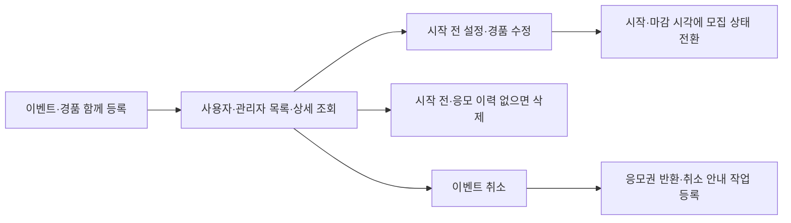

이벤트의 기간·멤버십·응모 조건과 등수별 경품·당첨 인원을 관리합니다. 실제 응모 접수·차감과 추첨·결과 공개는 각 기능과 연결합니다.

| 작업 | 처리 기준 |
| --- | --- |
| 등록·조회 | 이벤트와 경품을 함께 등록합니다. 관리자는 KST 날짜로 모집 기간이 겹치는 이벤트를 검색합니다. |
| 검색·목록 정보 | 관리자 정렬·가중치·등록일 조건과 모집 기간 조건을 조합합니다. 사용자 목록은 `myEntered`와 경품별 당첨 예정 인원 합계 `winnerCount`를 제공합니다. 합계는 실제 당첨자 수나 당첨 확률이 아닙니다. |
| 이미지 | JPG·PNG 파일을 먼저 S3에 업로드하고 반환된 키로 등록·수정합니다. 썸네일 `imageKey`, 상세 안내 `detailImageKey`, 경품별 `imageKey`를 저장하며 응답에서 공개 URL을 만듭니다. |
| 수정 | 시작 전 진행 예정 상태에서만 가능합니다. 시작 시각을 앞당길 수 없고, 기존 경품은 ID를 유지합니다. |
| 삭제 | 시작 전이고 응모 이력이 없을 때 `deleted_at`을 기록합니다. 이벤트·경품 행은 보존하고 목록·상세에서는 제외합니다. 배너는 관리자가 별도로 삭제합니다. |
| 취소 | 취소 상태·응모권 반환·취소 안내 작업·감사 기록을 함께 확정합니다. 이미 취소된 이벤트의 재요청은 409로 거절합니다. |
| 모집 상태 전환 | 전용 워커가 진행 예정 → 진행 중 → 마감을 처리합니다. 마감 +1분 자동 추첨과 관리자의 결과 공개는 별도 흐름입니다. |

**설계·기술 선택과 사용 이유**

- 조회는 JDBC로 검색·공개 상태 조건과 페이지 건수를 함께 다루고, 변경은 JPA와 이벤트 행 잠금으로 처리합니다. 잠금을 얻은 뒤 현재 시각을 다시 확인합니다.
- 이벤트·경품과 감사 기록, 취소와 반환을 같은 트랜잭션으로 묶어 "이벤트만 취소되고 응모권은 돌아오지 않는" 부분 처리를 막습니다. 알림은 작업 등록까지 함께 확정하고 실제 생성·발송은 워커가 처리합니다.
- 모집 상태 전환은 이벤트마다 따로 확정합니다. 이미 다른 처리가 잠근 이벤트는 건너뛰고(`SKIP LOCKED`), 한 이벤트가 실패해도 다음 이벤트를 처리합니다.
- 이미지 파일은 5,000,000바이트 이하이며 업로드 응답은 `imageKey`·`imageUrl`입니다. `target=EVENT`는 썸네일·상세 안내, `target=PRIZE`는 경품에 사용합니다. 상세 안내 이미지도 선택값이며 전체 교체 PUT에서 키 생략·null은 연결 제거입니다. 미사용·이전 S3 객체의 자동 삭제는 제공하지 않습니다.
- 사용자 목록·상세는 응모 불가능한 상위 멤버십 이벤트를 자동으로 숨기지 않습니다. 실제 응모에서 최소 등급을 검사하며, 목록의 `membershipRule`은 별도 검색 조건입니다.

**문제와 해결 과정**

- 요청을 받을 때는 시작 전이어도 잠금을 기다리는 동안 이벤트가 시작될 수 있습니다. 잠금 획득 후 시각·상태를 다시 검사해 수정·삭제를 거절합니다.
- 1등과 2등 경품의 등수를 바로 교환하면 중간에 중복 등수가 생깁니다. 비어 있는 임시 등수를 거쳐 같은 트랜잭션에서 교환하고 기존 경품 ID를 유지합니다.
- 여러 이벤트를 한 번에 확정하면 하나의 감사 저장 실패가 전체 전환을 막을 수 있습니다. 이벤트별로 롤백하고 마지막으로 시도한 ID 다음부터 순환 조회하도록 나눴습니다.

**검증 결과**

- 2026-10-16 KST, dev `15f2d95c`에서 event 패키지 **255개**(단위·MVC·설정 131 / MySQL 통합 124)가 성공했습니다. 실패·오류·건너뜀은 0개입니다.
- 등록·조회·수정·삭제·취소 조건과 실제 MySQL의 잠금 경합·실패 롤백·워커 동시 처리를 검증했습니다. 이 수치는 기존 실행 기록이며 이번 문서 수정에서는 테스트를 재실행하지 않았습니다.

자세한 처리 흐름·설계 이유·테스트 근거: [Wiki](https://github.com/Uplus-GETDDO/getddo-be/wiki/Mentoring-Event-Flows)

후속 구현 근거: [검색·내 응모 여부 #124](https://github.com/Uplus-GETDDO/getddo-be/pull/124) · [S3 업로드 #125](https://github.com/Uplus-GETDDO/getddo-be/pull/125) · [목록 당첨 예정 인원 #139](https://github.com/Uplus-GETDDO/getddo-be/pull/139) · [상세 안내 이미지 #171](https://github.com/Uplus-GETDDO/getddo-be/pull/171). 이미지 엔드포인트·상세 이미지 필드의 BE 구현 설명은 [이미지 문서](docs/02-api/event-images.md)에 있으며 공용 spec의 채택 상태와 구분합니다.

</details>

<details>
<summary>출석</summary>

<!-- 작성 담당: 윤태형 -->

**구현 기능·시연 흐름**

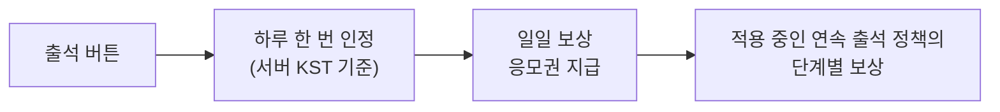

같은 날 다시 눌러도 보상은 한 번만 지급됩니다.

일일·연속 출석은 브론즈 응모권을 지급합니다. 관리자는 일일 정책을 다음 KST 자정, 연속 정책 묶음을 다음 기준월부터 적용하도록 예약합니다. 아직 적용되지 않은 예약의 보상 수량·단계는 수정할 수 있고, 현재·과거 정책이나 적용 시점 자체는 수정하지 않습니다([정책 등록 #119](https://github.com/Uplus-GETDDO/getddo-be/pull/119) · [예약 수정 #147](https://github.com/Uplus-GETDDO/getddo-be/pull/147)).

**설계·기술 선택과 사용 이유**

- 출석 기록, 보상 청구, 응모권 지급을 한 번에 확정해서 "출석은 됐는데 보상이 빠지는" 일이 없게 했습니다.
- 같은 날 동시에 눌러도 DB의 중복 방지(사용자 + 날짜)가 한 번만 처리되게 막습니다.

**문제와 해결 과정**

- 연타나 자정 직후 요청에서 보상이 두 번 나갈 수 있었습니다. DB 중복 방지를 마지막 방어선으로 두고, 충돌하면 한 번만 다시 처리해 먼저 확정된 결과를 돌려줍니다.

자세한 내용은 [Wiki](https://github.com/Uplus-GETDDO/getddo-be/wiki/Mentoring-Domain-Flows#출석)

</details>

<details>
<summary>미션</summary>

<!-- 작성 담당: 윤태형 -->

**구현 기능·시연 흐름**

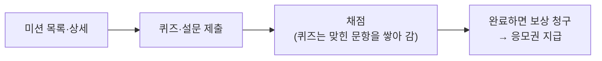

이미 완료한 미션은 다시 제출해도 보상이 더 나오지 않습니다.

**설계·기술 선택과 사용 이유**

- 제출 ID를 DB 기본키로 써서, 같은 요청이 동시에 와도 한 번만 처리됩니다.
- 재전송이 같은 요청인지는 처음 요청의 해시(요약값)로 구분합니다. 지급이 실패하면 제출·답변·청구가 모두 취소됩니다.
- 퀴즈의 문항별 동시 제출은 같은 사용자 행을 먼저 잠근 뒤 완료 여부를 판정합니다. 요청 도착 시각을 한 번 정해 재처리에도 유지하므로 잠금을 기다리는 동안 운영 기간이 끝나도 기간 안에 도착한 요청은 접수합니다. 설문 제출에는 이 사용자 행 잠금을 추가하지 않습니다.

**문제와 해결 과정**

- 이미 맞힌 문항의 답은 저장하지 않아서, 재전송 내용을 저장된 답과 비교할 수 없었습니다. 처음 요청의 해시를 저장하도록 했습니다.
- 서버 2대에서 퀴즈 정답을 나눠 동시에 제출할 때 서로의 진행을 보지 못해 완료·보상이 누락되던 문제를 사용자 행 잠금으로 수정했습니다([PR #184](https://github.com/Uplus-GETDDO/getddo-be/pull/184)). 수정 뒤 서버 재시험에서 누락 패턴·중복은 없었지만 당시 풀 소진 503은 별도 문제였으며 [정합성 검증](#정합성-검증)에 구분했습니다.

관리자는 미션·문항·보상 정책을 함께 등록하고, 설문 선택지 집계와 자유 서술 답변을 조회합니다. 서술 답변은 사용자·제출 ID 없이 익명으로 제공합니다. 종료 워커는 운영 종료된 미션을 `ENDED`로 바꾸며, 제출 가능 여부는 워커 실행과 무관하게 요청 도착 시각·운영 기간으로 판정합니다([미션 관리 #120](https://github.com/Uplus-GETDDO/getddo-be/pull/120) · [종료 워커 #146](https://github.com/Uplus-GETDDO/getddo-be/pull/146) · [익명 답변 #148](https://github.com/Uplus-GETDDO/getddo-be/pull/148)).

자세한 내용은 [Wiki](https://github.com/Uplus-GETDDO/getddo-be/wiki/Mentoring-Domain-Flows#미션)

</details>

<details>
<summary>응모권</summary>

<!-- 작성 담당: 윤태형 -->

**구현 기능·시연 흐름**

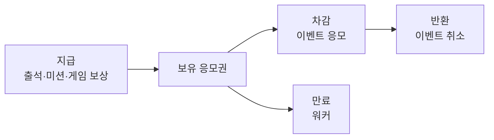

응모권 한 장이 DB의 한 행이고, 바뀔 때마다 이력이 한 줄씩 쌓입니다.

브론즈·실버·골드·플래티넘 네 등급을 사용합니다. 게임·미션의 기본 무작위 지급 확률은 각각 **79.98%·18%·2%·0.02%**이며, 출석은 브론즈 고정입니다. `platinum-bp=0`은 지급을 중지하는 설정이고 현재 코드 기본값은 `2`로 활성화돼 있습니다. 환경별 실제 확률은 설정을 확인합니다([플래티넘 지원 #126](https://github.com/Uplus-GETDDO/getddo-be/pull/126) · [지급 활성화 #129](https://github.com/Uplus-GETDDO/getddo-be/pull/129)).

**응모권 트랜잭션**

응모 한 건은 하나의 트랜잭션(격리 수준 `READ_COMMITTED`)에서 응모 기록, 응모권 차감, 이력을 함께 확정하거나 함께 취소합니다.

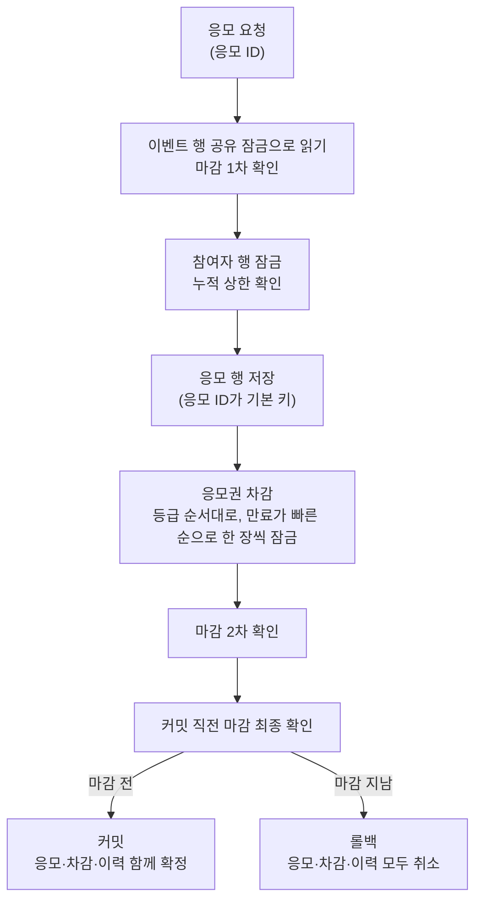

- 차감 서비스는 **호출자의 트랜잭션에 참여**하고 자체적으로 커밋하지 않습니다. 트랜잭션 없이 호출하면 실패하게 막았습니다(`MANDATORY`).
- 같은 응모 ID로 다시 호출하면 추가로 차감하지 않고 기존 결과를 돌려줍니다. 같은 ID가 **동시에** 오는 경우는 응모 행 저장(기본 키)이 하나로 직렬화합니다.
- 잠금 순서를 고정했습니다. 등급은 정해진 순서로 정렬해 잠그고, 같은 등급 안에서는 만료가 빠른 응모권부터 한 장씩 잠가서 같은 사용자의 동시 차감이 서로 기다릴 뿐 교착하지 않게 했습니다.
- 후보 응모권과 사용 이력은 **잠그지 않고 읽습니다.** 범위에 `FOR UPDATE`를 걸지 않아 gap lock이 생기지 않게 한 것이고, 그래서 `READ_COMMITTED`가 전제입니다.
- 예외는 삼키지 않고 그대로 전파합니다. 삼키면 "응모는 있는데 차감은 없는" 상태가 생기기 때문입니다.
- 지급·반환·만료도 같은 규약을 따릅니다. 반환은 이벤트 취소와 같은 트랜잭션에서 일어납니다.
- 거절 기록은 응모가 롤백된 뒤 별도 트랜잭션에 남기고, 같은 ID로 다시 보내면 처음과 같은 오류를 돌려줍니다.

관리자 지급·이력 조회에는 최신순 인덱스를 추가하고, 건수 조회의 불필요한 조인을 제거했습니다. 정합성 조회는 현재 버전 이력을 직접 대조합니다. [PR #191](https://github.com/Uplus-GETDDO/getddo-be/pull/191)의 로컬 MySQL 비교와 실제 스테이징 적용 후 성능은 구분하며, 전체 스캔이 남은 정합성 조회의 지연 상한은 보장하지 않습니다.

**설계·기술 선택과 사용 이유**

- 후보를 먼저 읽고 한 장씩 잠가서, 동시에 써도 어긋나지 않게 했습니다.
- 반환은 상태가 이상할 때만 이력을 잠그며 읽어서, 요청끼리 서로 맞물려 멈추는 일(교착)을 피했습니다.
- 만료는 다른 처리가 이미 잡고 있는 응모권을 건너뛰어(`SKIP LOCKED`), 서버가 여러 대일 때도 한 장을 두 번 만료하지 않도록 했습니다.

**문제와 해결 과정**

- 반환 이력을 항상 잠그며 읽었더니, 동시에 반환하는 요청들이 서로 맞물려 멈췄습니다(교착). 원인을 MySQL 교착 기록으로 확인하고, 상태가 이상할 때만 확인하도록 고쳤습니다.

**테스트 결과 (직접 측정)**

- 반환 이력 읽기: 대안은 60회 중 60회 교착, 채택한 방식은 0회입니다. 만료 워커 4대는 약 3.5초(대안 20.9초)입니다. 노트북 한 대에서 잰 상대 비교입니다.

자세한 내용은 [Wiki](https://github.com/Uplus-GETDDO/getddo-be/wiki/Mentoring-Domain-Flows#응모권)

</details>

<details>
<summary>이벤트 응모</summary>

<!-- 작성 담당: 윤태형 -->

**구현 기능·시연 흐름**

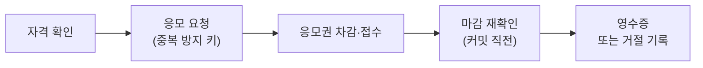

같은 키로 다시 보내면 처음 결과를 돌려주고, 거절도 기록해 두었다가 같은 오류를 돌려줍니다.

관리자는 접수·거절 이력과 이벤트별 응모자를 조회할 수 있습니다. 응모 이력은 요청별 처리 결과이고, `event_participants`는 성공한 사용자·이벤트 조합의 응모자 명단입니다. 관리자 응답의 이름은 현재 사용자 정보를 일괄 조회해 보충하며 기존 ID·응모 기록은 유지합니다([응모 조회 #118](https://github.com/Uplus-GETDDO/getddo-be/pull/118) · [이름 응답 #153](https://github.com/Uplus-GETDDO/getddo-be/pull/153)).

**설계·기술 선택과 사용 이유**

- 이벤트 행을 공유 잠금으로 읽어서 응모끼리 서로 기다리지 않게 했고, 마감은 시작·차감 뒤·커밋 직전에 세 번 확인합니다.
- 거절 기록은 응모가 취소돼도 남도록 별도 트랜잭션에 씁니다.

**문제와 해결 과정**

- 마감 직후에 커밋된 응모가 추첨 후보가 될 수 있었습니다. 커밋 직전 확인을 추가했고, 남는 아주 짧은 틈은 공용 명세에 예외로 승인했습니다.

**테스트 결과 (직접 측정)**

- 같은 이벤트에 64명이 동시에 응모하면 공유 잠금은 102건/초, 쓰기 잠금은 23건/초로 약 4.4배 차이가 납니다. 노트북 한 대에서 잰 상대 비교입니다.

자세한 내용은 [Wiki](https://github.com/Uplus-GETDDO/getddo-be/wiki/Mentoring-Domain-Flows#이벤트-응모)

</details>

<details>
<summary>요청 빈도 제한</summary>

<!-- 작성 담당: 윤태형 -->

**구현 기능·시연 흐름**

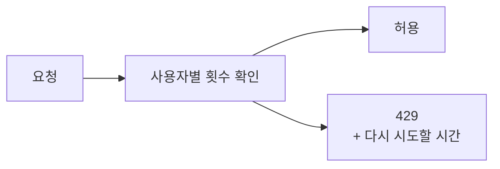

응모·출석·미션 제출·게임 결과 제출에 적용합니다. 업무 저장 전에 제한을 판정하며, 사용자 문맥·이벤트 연결 확인을 위한 DB 조회는 선행할 수 있습니다. 이미 활성화된 응모 차단은 헤더 형식 확인 후 DB 조회 없이 거절합니다. 응모는 사용자당·이벤트당 한도를 따로 두고, 거절이 짧은 시간에 반복되면 [응모 자동 일시 차단](#entry-auto-blocking)으로 이어집니다.

**설계·기술 선택과 사용 이유**

- 서버 메모리로만 세면 서버가 여러 대일 때 한도가 서버마다 따로 적용됩니다. 그래서 횟수 저장소를 바꿀 수 있게 만들었고, Redis 구현은 서버 여러 대의 횟수를 한곳에서 셉니다.

**문제와 해결 과정**

- 서버가 여러 대일 때 한도가 서버마다 따로 적용되는 한계를 Redis 구현으로 풀었습니다. 개발 서버는 Redis 저장소 설정을 사용합니다. 스테이징 API 서버 2대에서 같은 사용자가 25번 호출했을 때 11번째부터 429가 나와 한도가 합산되는 것을 확인했습니다(25번이 두 서버에 고르게 나뉜 것은 요청별로 확인하지 못했습니다).

자세한 내용은 [Wiki](https://github.com/Uplus-GETDDO/getddo-be/wiki/Mentoring-Domain-Flows#요청-빈도-제한)

</details>

<details>
<summary>추첨·결과 공개</summary>

<!-- 작성 담당: 석종수 -->

#### 전체 추첨 흐름

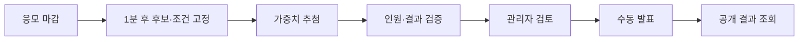

추첨은 자동으로 실행하고, 사용자에게 결과를 공개하는 시점은 관리자가 결정합니다. 확정된 결과는 같은 실행을 다시 요청해도 바뀌지 않습니다.

#### 후보·가중치 확정

성공한 응모와 실제 응모권 사용 이력을 대조해 후보를 구성합니다. 응모에 기록된 차감 수량, 실제 사용 이력 개수, 응모자 누적 사용량이 일치해야 합니다. 티켓 소유자와 중복 이력도 검사합니다.

```text
가중치 = 브론즈 사용 장수 × 1
       + 실버 사용 장수 × 3
       + 골드 사용 장수 × 5
       + 플래티넘 사용 장수 × 10
```

골드·실버·브론즈를 한 장씩 사용하면 **후보는 1명, 실제 사용량은 3장, 가중치는 9**입니다. 가중치 미적용·응모권 미사용 이벤트는 후보별 가중치가 1입니다.

신규 스냅샷은 네 등급의 실제 장수·가중치를 보존합니다. 플래티넘이 없던 과거 스냅샷은 당시 버전대로 해석하며 저장된 결과를 소급 변경하지 않습니다([PR #128](https://github.com/Uplus-GETDDO/getddo-be/pull/128)).

| 저장 위치 | 보존하는 내용 |
| --- | --- |
| `draw_candidates` — 최초 후보 스냅샷 | 실제 장수·가중치·응모 및 차감 근거 |
| `draw_run_candidates` — 실행별 후보 연결 | 해당 실행에 실제 포함한 후보 |
| `draw_runs.rules_snapshot` — 실행 조건 | 경품·등수·당첨 인원·가중치 기준 |

입력이 고정된 이후에는 현재 응모 데이터를 다시 계산하지 않고 저장된 스냅샷을 사용합니다.

최초 후보·실행 연결 저장 구간에 Hibernate 배치 크기 100을 적용하고, 성공·실패 모두 이전 세션 설정을 복원합니다. 드라이버의 실제 묶음 전송 효과에는 JDBC 설정도 관여하므로 코드의 배치 크기만으로 운영 성능 향상을 단정하지 않습니다([PR #140](https://github.com/Uplus-GETDDO/getddo-be/pull/140)).

#### 가중치 추첨

전체 가중치 범위에서 정수 난수를 뽑고, 누적 구간에 해당하는 후보를 선정합니다.

| 후보 | 가중치 | 난수 구간 | 첫 번째 선정 확률 |
| --- | ---: | --- | ---: |
| A | 1 | 0 | 1/9 |
| B | 3 | 1~3 | 3/9 |
| C | 5 | 4~8 | 5/9 |

난수가 6이면 C가 당첨됩니다. 이후 C를 후보에서 제거하고 전체 가중치에서도 5를 빼므로, 다음 선정은 A·B의 가중치 합계 4를 기준으로 진행합니다.

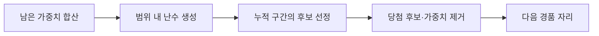

- 운영 난수는 `SecureRandom`을 사용하고, 범위 밖의 값은 다시 생성합니다.
- 전체 가중치는 `BigInteger`로 합산해 `long` 합계 범위 초과를 처리합니다.
- 상위 등수부터 선정하며 당첨자를 제거하므로 같은 사용자가 다른 경품에도 중복 당첨되지 않습니다.
- `개인 가중치 ÷ 남은 전체 가중치`는 각 선정 단계의 확률입니다.

#### 경품별 자리와 당첨 인원 검증

경품의 당첨 인원을 자리로 나누고, `draw_results`에 자리마다 `SELECTED` 또는 `UNFILLED` 결과를 저장합니다.

예를 들어 후보가 3명이고 경품 자리가 5개라면 다음과 같습니다.

| 경품 자리 | 결과 | 당첨자 |
| --- | --- | --- |
| 1등 1번 | SELECTED | A |
| 2등 1번 | SELECTED | B |
| 2등 2번 | SELECTED | C |
| 3등 1번 | UNFILLED | 없음 |
| 3등 2번 | UNFILLED | 없음 |

```text
결과 행 수 = 전체 경품 자리 수
당첨 인원 = min(후보 수, 전체 경품 자리 수)
미충원 수 = 전체 자리 수 - 당첨 인원
```

저장 전에는 자리 누락·중복, 후보에 없는 사용자, 사용자 중복, 선정 순서와 조기 미충원을 검사합니다. 응모자가 아예 없으면 `NO_ENTRIES`로 정상 종료하고 결과 행을 만들지 않습니다.

관리자 검사 API는 저장된 후보·조건·결과를 대조하고 `draw_checks`에 검사자·시각·항목별 결과를 추가합니다. 검사 과정에서 당첨자를 다시 뽑거나 기존 결과를 수정하지 않습니다.

#### 개별 당첨 취소·재추첨

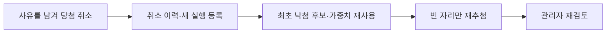

기존 결과를 삭제하거나 덮어쓰지 않고 `award_cancellations`에 취소 이력을 추가합니다. 최초 후보 중 기존 당첨자와 당첨 취소자를 제외하며, 취소 대상이 아닌 당첨자와 경품은 유지합니다.

재추첨은 최초 후보 상세를 복사하지 않고 새 실행에 연결합니다. 결과도 이번에 보충할 자리만 새 행으로 저장합니다.

#### 결과 확정과 공개

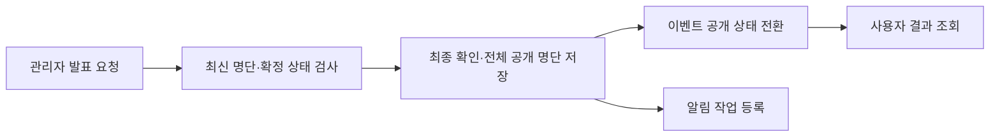

발표 요청 한 번으로 필요한 실행별 확인 기록, 전체 공개 명단, 이벤트 상태 변경과 알림 작업 등록을 같은 트랜잭션에서 처리합니다.

| 저장 위치 | 역할 |
| --- | --- |
| `draw_result_confirmations` — 결과 최종 확인 이력 | 실행별 확인자·확인 시각 |
| `draw_publications` — 공개 명단 버전 | 실제 발표자·공개 시각·버전 |
| `draw_publication_results` — 공개 결과 연결 | 유지 당첨자와 재추첨 당첨자를 합친 실제 명단 |
| `draw_publication_executions` — 공개 실행 확인 근거 | 당첨자가 없는 실행까지 포함한 확인 근거 |

사용자는 실제 공개 버전의 결과를 조회합니다. 공개 전에는 당첨 정보를 숨기고, 공개 명단에는 마스킹한 이름과 전화번호 끝 4자리를 제공합니다.

관리자 응답에는 현재 사용자·처리자 이름을 일괄 조회로 보충하되 저장된 후보·결과·감사 원문은 유지합니다. 발표 확인 시각은 MySQL `DATETIME(6)` 정밀도에 맞춰 마이크로초로 절삭해 반올림에 의한 미래 시각 오탐을 막습니다([이름 응답 #158](https://github.com/Uplus-GETDDO/getddo-be/pull/158) · [확인 시각 #168](https://github.com/Uplus-GETDDO/getddo-be/pull/168)).

#### 중복 요청·실패 시 처리

| 상황 | 처리 |
| --- | --- |
| 같은 최초 추첨 등록 요청 | 기존 실행 재사용, 이벤트·차수 UNIQUE로 중복 등록 방지 |
| 이미 확정된 실행 재요청 | 저장된 결과 ID·당첨 순서 반환 |
| 결과 저장 중 실패 | 결과와 확정 상태를 함께 롤백, 등록된 실행 ID 유지 |
| 실행 중 서버 중단 | 소유권 만료와 실패·재시도 상태를 기준으로 같은 실행 복구 |
| 검토 후 명단 변경 | 이전 실행 ID의 발표 요청 거절 |
| 같은 성공 발표 재요청 | 기존 공개 버전 반환, 확인·공개·알림 작업 중복 생성 방지 |
| 공개 후 알림 처리 실패 | 알림 재시도로 처리하고 확정·공개 결과 유지 |

#### 설계·기술 선택과 사용 이유

| 선택 | 사용 이유 |
| --- | --- |
| 순수 선정기와 저장 서비스 분리 | DB 없이 가중치 구간과 선정 순서를 검증하고, API·워커가 같은 업무 로직 재사용 |
| 실행 등록·입력 준비·결과 확정 분리 | 중단·실패 후에도 실행 ID와 고정 입력을 유지 |
| 이벤트 → 실행 잠금 | 같은 이벤트의 동시 확정과 실행 간 배정 충돌 제어 |
| UNIQUE·복합 FK | 실행별 자리·후보·순서 중복과 잘못된 후보 연결 방지 |
| 불변 결과·별도 취소 이력 | 최초 선정부터 취소·재추첨까지 원래 근거 추적 |
| 공개 버전 분리 | 내부 변경과 실제 사용자 공개 명단 구분 |

#### 검증 결과

| 검증 범위 | 실행 기록일·관련 작업 | 결과 |
| --- | --- | --- |
| 실제 응모·차감과 후보 스냅샷 | 2026-10-15, GD-131 | 관련 MySQL 검증 17개 성공 |
| 공개 명단·본인 결과·마스킹 | 2026-10-15, GD-140 | 관련 검증 26개 성공 |
| 공개·취소·재추첨·사용자 조회 | 2026-10-15~16, GD-199 구현본 | 관련 MySQL 검증 39개 성공, 전체 테스트·빌드 2,215개 성공 |

가중치 구간 경계, 후보 부족, 잘못된 수량·가중치·자리, 실제 잠금 경합, 동시 확정과 저장 실패 롤백을 검증했습니다. 전체 테스트 수는 프로젝트 전체 집계이며 이번 README 수정에서는 테스트를 재실행하지 않았습니다.

[상세 시퀀스 다이어그램](https://github.com/Uplus-GETDDO/getddo-be/wiki/Mentoring-Drawing-Sequences)

</details>

<a id="entry-auto-blocking"></a>

<details>
<summary>응모 자동 일시 차단·이력 조회</summary>

<!-- 작성 담당: 석종수 -->

**구현 기능·시연 흐름**

응모 요청이 일반 빈도 제한으로 반복 거절되면 사용자를 일시 차단하고 `429`·`Retry-After`로 안내합니다. 기본 응모 한도는 사용자 분당 20회·같은 이벤트 분당 10회이고, 거절 누적 기준을 충족하면 기본 10분 차단합니다. 이 한도·집계·차단 기간은 서로 다른 설정이며, 사용자·이벤트 기준을 동시에 충족하면 USER 근거 한 건을 기록합니다.

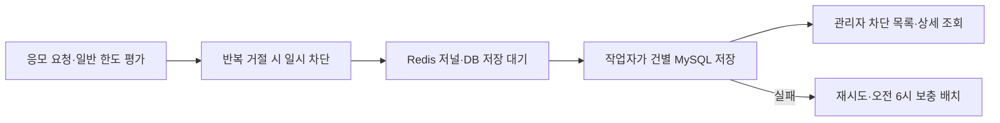

**설계·기술 선택과 사용 이유**

- Redis 모드는 단일 Lua 평가로 제한·거절 집계·최초 차단·저널·저장 대기를 처리합니다. 차단 중 호출이 기존 종료 시각을 연장하거나 이력을 늘리지 않습니다.
- DB 커밋 후에만 저장 완료를 표시하고, 실패 시 최초 ID·시각·근거를 유지해 재시도합니다. 기본 재시도 예산 이후에는 KST 오전 6시 배치로 넘기며, 한 건이 실패해도 다른 건을 처리합니다.
- 활성 차단 판정을 확인하지 못한 Redis 장애와 이미 확정된 429 뒤의 기록 실패를 구분합니다. 메모리 모드는 프로세스 단위 제한이고 Redis 저널·DB 저장 이력을 만들지 않습니다.
- 관리자 AR01·AR02는 자동 차단 내역과 판정 근거만 제공합니다. 정상 접수한 응모를 추첨에서 제외하거나 응모권을 회수하는 기능은 아닙니다. Redis 전체 데이터가 유실되면 DB 미저장 근거도 유실될 수 있습니다.

**검증 근거**

[PR #159](https://github.com/Uplus-GETDDO/getddo-be/pull/159)는 Redis 책임 분리·Lua·연결 풀을, [PR #172](https://github.com/Uplus-GETDDO/getddo-be/pull/172)는 실제 작업자 → Redis 선점 → DB 저장 → 관리자 조회 통합 경로를 다룹니다. PR #172의 최종 [CI 기록](https://github.com/Uplus-GETDDO/getddo-be/actions/runs/39940799391)에 실제 저장소 통합·빌드·이미지 검사 성공이 기록돼 있습니다. 로컬 통합 미실행 및 운영 부하 검증과 구분합니다.

구현 안내: [응모 자동 차단](docs/02-api/entry-auto-blocking.md) · [관리자 차단 조회](docs/02-api/abuse-cases.md) · [저장 작업자 런북](docs/06-runbook/abuse-history-worker.md).

</details>

<details>
<summary>알림</summary>

<!-- 작성 담당: 전민규 -->

#### 전체 알림 흐름

```mermaid
flowchart LR
    Event["이벤트 시작·변경·취소"] --> Job["알림 작업 저장"]
    Job --> Worker["워커가 작업 선점"]
    Worker --> Create["사용자별 알림 생성"]
    Create --> Send["모의 발송"]
    Create --> Inbox["내 알림함 조회·읽음"]
```

업무가 성공했을 때 알림 작업도 함께 저장하고, 실제 사용자별 알림 생성은 워커가 처리합니다. 사이트 내 알림함을 제공하며 외부 문자·이메일·푸시는 모의 발송으로 대체합니다. **발송 성공과 사용자가 읽은 상태는 별개**입니다.

#### 시작 알림과 수신 대상 확정

시작 10분 전부터 시작 직전 사이의 이벤트를 확인하고, 그 시점에 응모 자격을 충족하는 활성 일반 사용자를 수신자로 정합니다. 10분 전을 놓쳤더라도 시작 전이면 등록하며, 시작 시각이 지난 이벤트의 새 시작 작업은 등록하지 않습니다.

| 확인 항목 | 처리 |
| --- | --- |
| 이벤트 상태 | 삭제·취소되지 않은 진행 예정 이벤트만 선택 |
| 멤버십 | 이벤트의 최소 멤버십 이상인 활성 일반 사용자 선택 |
| 수신 대상 | 작업에 목록을 저장하고 이후 재시도에서도 같은 대상 유지 |
| 반복 폴링 | 발생 키로 기존 작업을 재사용하고 DB UNIQUE로 중복 등록 방지 |

예를 들어 수신자가 A·B·C이고 A·B의 알림만 만든 뒤 실패했다면, 재처리에서는 기존 두 알림을 유지하고 C의 알림을 이어서 만듭니다.

#### 일정 변경·취소·삭제

```mermaid
flowchart LR
    Change["일정 변경·취소"] --> Stop["예전 시작 작업의 추가 생성 중지"]
    Stop --> Recipients["이미 시작 알림을 받은 사용자 확정"]
    Recipients --> Notice["별도 변경·취소 안내 작업 저장"]
    Notice --> Worker["기존 워커로 알림 생성"]
```

| 상황 | 처리 |
| --- | --- |
| 시작 안내를 아직 아무도 받지 않은 일정 변경 | 예전 작업의 생성을 중지하고 새 일정의 10분 전 구간에서 시작 안내 등록 |
| 일부 사용자에게 시작 안내가 생성된 뒤 일정 변경 | 남은 생성을 중지하고 이미 받은 사용자에게 별도 변경 안내 |
| 이벤트 취소 | 시작 작업의 추가 생성 중지, 이미 받은 사용자에게 취소 안내 |
| 이벤트 논리 삭제 | 시작 작업의 추가 생성만 중지. 별도 삭제 알림은 생성하지 않음 |

이벤트 변경·취소와 안내 작업 등록은 같은 트랜잭션으로 처리합니다. 이미 생성한 알림의 문구·읽음·발송 결과는 덮어쓰지 않습니다.

#### 실패 재시도와 관리자 복구

```mermaid
flowchart LR
    Attempt["생성·모의 발송 시도"] --> Check{"일시적 실패?"}
    Check -->|"예"| Retry["최대 3회 자동 재시도"]
    Check -->|"입력·제약 오류"| Failed["최종 실패 기록"]
    Retry -->|"모두 실패"| Failed
    Retry -->|"성공"| Done["처리 종료"]
    Failed --> Review["관리자 원인 확인·복구 접수"]
    Review --> NewCycle["새 복구 구간에서 워커 처리"]
```

생성과 모의 발송은 각각 **최초 1회 + 자동 재시도 최대 3회**를 적용합니다. 일시적 오류의 재시도 간격은 10초·30초·60초이며, 입력·제약 오류는 즉시 최종 실패로 기록합니다. 관리자 복구는 최종 실패 건만 대상으로 하며 정상 완료 건을 재발송하는 기능은 제공하지 않습니다.

#### 내 알림 조회와 읽음

커서 기반으로 본인 알림을 조회하고 읽음 여부로 필터링합니다. 목록 조회만으로는 읽음 처리하지 않으며, 개별 읽음·전체 읽음은 본인의 미읽음 알림만 변경합니다. 이미 읽은 본인 알림의 재요청은 같은 상태를 유지합니다.

#### 설계·기술 선택과 사용 이유

| 선택 | 사용 이유 |
| --- | --- |
| DB 작업 저장 + 스케줄러 | 업무와 작업을 함께 커밋하고 HTTP 요청에서 전체 알림 생성을 기다리지 않도록 처리 |
| 발생 키·사용자별 UNIQUE | 같은 발생 건과 같은 수신자의 알림이 재처리에서 중복 생성되는 상황 방지 |
| 수신 대상·진행 위치 보존 | 중간 실패 후 최초 대상과 이미 만든 알림을 유지하며 이어 처리 |
| 선점 만료·누적 처리 차수 | 중단된 워커의 작업을 이어받고 이전 워커의 늦은 결과 갱신 차단 |
| 읽음·발송 상태 분리 | 발송 성공이나 복구 요청이 사용자 읽음 상태를 바꾸지 않도록 관리 |

#### 대량 알림 묶음 처리와 예약 순서 인덱스

- 사용자별 생성은 최대 100명씩 JDBC batch로 저장하고 묶음별로 커밋합니다. 실패한 묶음은 롤백하지만 앞서 완료한 묶음과 진행 위치는 보존합니다.
- 발송 대상도 최대 100건을 선점합니다. 각 모의 발송의 성공·실패 판정을 보관한 뒤 결과를 묶음 저장하고, 저장 실패 시 발송기를 다시 호출하지 않고 동일 결과만 개별 저장합니다. 등록·생성 작업의 최대 20건과 사용자 알림의 100건 단위는 다릅니다.
- 결과 저장은 최초 선점부터 60초의 임대 예산과 상태·선점 차수·복구 차수를 검사해 늦은 결과가 새 처리를 덮지 않도록 합니다. 기본 모의 실패율 20%, 재시도 10·30·60초와 최초 포함 최대 4회는 유지합니다.
- 대형 수신자 JSON을 가진 작업의 선점 정렬에서 발견된 `Out of sort memory`에 대응해 V032에서 `(scheduled_at, id)` 인덱스를 추가했습니다. 실행계획·선점 회귀 검증과 1만 명 전체 생성·발송 완료 시험은 서로 다른 범위입니다.
- 관리자 발송 이력·복구 응답에는 현재 수신자 이름 `userName`을 제공합니다. 기존 알림 내용·사용자·읽음·발송 상태는 이름 보충으로 바꾸지 않습니다.
- 관리자 작업 목록은 큰 수신자 payload를 가진 행 전체를 정렬하는 대신 ID 페이지를 먼저 구하고 해당 행만 조회합니다. 예약 작업 선점과 관리자 최신순 목록은 별도 조회 경로입니다([PR #192](https://github.com/Uplus-GETDDO/getddo-be/pull/192)).

후속 구현·검증 기록: [이름 #155](https://github.com/Uplus-GETDDO/getddo-be/pull/155) · [모의 실패 #173](https://github.com/Uplus-GETDDO/getddo-be/pull/173) · [생성 묶음 #177](https://github.com/Uplus-GETDDO/getddo-be/pull/177) · [발송 묶음 #180](https://github.com/Uplus-GETDDO/getddo-be/pull/180) · [예약 인덱스 #189](https://github.com/Uplus-GETDDO/getddo-be/pull/189). PR #180은 관련 단위 157개와 최종 CI 통합·빌드 성공을 기록합니다. 이전 로컬 처리 시간 비교는 후속 임대 예산 수정 전의 측정이며 현재 운영 성능으로 환산하지 않습니다.

#### 중복 요청·실패 시 처리

| 상황 | 처리 |
| --- | --- |
| 같은 발생 키·같은 입력 | 기존 작업 ID 반환 |
| 같은 발생 키·다른 입력 | 충돌로 거절하고 기존 작업 보존 |
| 일부 사용자 알림 생성 뒤 실패 | 이미 생성한 알림 유지, 나머지 대상 이어 처리 |
| 작업을 다른 워커가 재선점 | 이전 처리 차수의 늦은 완료·실패 갱신 차단 |
| 관리자 복구 후 재시도 | V021의 복구 기준 차수로 새 시도 구간을 계산하며 누적 차수 유지 |
| 타인 알림 읽음 요청 | 없는 알림과 동일한 부재 응답으로 처리 |

#### 검증 결과

**초기 기능 실행 기록**: 2026-10-16 KST, 당시 dev `88833cef`를 반영한 `docs/GD-212`의 코드 `2d2f1664`. Java 21·Testcontainers MySQL 8.4에서 담당 테스트를 필터링한 결과입니다. 이후 이름·게임 추가·알림 묶음 처리의 최신 테스트 수와 합산하지 않습니다.

| 검증 종류 | 실행 수 | 결과 |
| --- | ---: | --- |
| 알림 단위·MVC·매퍼 | 104 | 성공 |
| 알림 API·DB 통합 | 88 | 성공 |
| **알림 합계** | **192** | **실패·오류·건너뜀 0** |

- 수신 자격과 시작 10분 전 경계, 반복 폴링·동시 등록·부분 생성 뒤 재시도를 검증했습니다.
- 본인만 읽음 처리, 기존 알림 보존, 일정 변경·취소, 선점 만료·이전 워커 갱신 차단을 확인했습니다.
- 관리자 복구의 자격·새 재시도 구간·중복 복구 거절·감사 저장 실패 시 롤백을 검증했습니다.

<a id="gd212-owned-test-command"></a>

<details>
<summary>직접 실행한 담당 범위 테스트 명령</summary>

```bash
./gradlew \
  :core:test --tests 'com.getddo.core.notification.*' \
    --tests 'com.getddo.core.game.*' \
    --tests 'com.getddo.core.user.service.AdminUserQueryServiceTest' \
  :api:test --tests 'com.getddo.api.notification.*' --tests 'com.getddo.api.game.*' \
  :storage:db:test --tests 'com.getddo.db.notification.*' --tests 'com.getddo.db.game.*' \
  :api:integrationTest --tests 'com.getddo.api.notification.*' \
    --tests 'com.getddo.api.game.*' --tests 'com.getddo.api.user.AdminUserIntegrationTest' \
  :storage:db:integrationTest --tests 'com.getddo.db.notification.*' --tests 'com.getddo.db.game.*' \
  --rerun-tasks --init-script gradle/test-limits.init.gradle \
  --max-workers=1 --no-parallel --no-daemon --console=plain
```

</details>

위 명령 전체의 담당 범위 집계는 **354개 성공**이며, 알림 외에는 아래 게임·관리자 사용자 조회가 포함됩니다. 전체 프로젝트 테스트·빌드 성공을 뜻하지 않습니다.

실행 코드: [알림 서비스](core/src/main/java/com/getddo/core/notification/service) · [알림 API 통합 테스트](api/src/integrationTest/java/com/getddo/api/notification) · [알림 DB 통합 테스트](storage/db/src/integrationTest/java/com/getddo/db/notification). 현재 처리 구조와 과거 단계별 측정·장애 대응은 [워커 운영 문서](docs/06-runbook/notification-worker.md)에서 구분해 확인합니다.

</details>

<details>
<summary>게임</summary>

<!-- 작성 담당: 전민규 -->

#### 게임 소개

게임별 대표 이미지와 플레이 방식입니다.

<!-- 이미지 원본: https://getddo-fe.vercel.app/images/games/{takoyaki-run,color-word,takko-timing}.jpg. 타꼬 주문은 FE cc1ea7bb의 public/images/games/takko-order.jpg(배포 주소 미반영). 원본 이미지를 수정 없이 보관한다. -->

| 타꼬런 | 글자색깔 맞추기 |
| :---: | :---: |
|  |  |
| 소스병과 꼬치를 점프로 피하며 달리는 게임입니다.<br>장애물을 피해 오래 버틸수록 점수가 올라갑니다. | 글자의 뜻에 속지 않고 글자에 칠해진 색을 고르는 게임입니다.<br>정답을 맞힐수록 제한 시간이 짧아집니다. |
| **타꼬 타이밍 맞추기** | **타꼬 주문** |
|  |  |
| 움직이는 이쑤시개를 타꼬에 맞춰 꽂는 게임입니다.<br>가운데에 정확히 맞추며 점수를 쌓습니다. | 손님의 주문을 기억하고 같은 순서로 메뉴를 내주는 게임입니다.<br>정답을 맞힐수록 기억해야 할 주문이 길어집니다. |

#### 전체 게임 처리 흐름

```mermaid
flowchart LR
    Select["게임 조회·선택"] --> Start["플레이 ID·토큰 발급"]
    Start --> Play["플레이·답변 기록"]
    Play --> Judge["서버 점수 판정"]
    Judge --> Save["결과·통계·보상 확정"]
    Save --> Result["결과·내 통계 조회"]
```

현재 서버는 네 게임의 시작·결과 검증·통계·일일 보상을 지원합니다. 공통 API를 재사용하고 게임별 시작 처리기·검증기가 저장된 규칙과 입력을 해석합니다.

| 게임 | 서버가 검증하는 입력 | 하루 첫 보상의 최소 점수 |
| --- | --- | ---: |
| 글자색깔 맞추기 (`COLOR_WORD`) | 선택 답·순서·소요 시간·타임아웃 | 50 |
| 타꼬런 (`TAKKO_RUN`) | 시작 seed·종료 tick·점프 입력 | 400 |
| 타꼬 타이밍 | 이쑤시개 입력 시각·퍼펙트/일반 적중·종료 | 50 |
| 타꼬 주문 | 주문 선택 기록·정답 순서·실패·종료 | 18 |

보상은 게임별·사용자별 KST 하루 1장이고, 활성 게임·유효 보상 정책 데이터가 필요합니다. 아래 50점·답변 기록 설명과 10월 16일 검증 표는 색깔 게임의 예시이며 다른 게임의 점수 규칙으로 적용하지 않습니다. 후속 구현·CI 기록은 [타꼬런 #113](https://github.com/Uplus-GETDDO/getddo-be/pull/113) · [타이밍·주문 #136](https://github.com/Uplus-GETDDO/getddo-be/pull/136)을 참고합니다.

#### 플레이 시작과 검증 기준 보관

플레이 시작 시 ID와 토큰을 발급하고, 그때의 규칙·생성 버전·seed를 저장합니다. 게임 설정이 나중에 바뀌어도 해당 플레이는 시작 당시 기준으로 판정합니다.

| 저장 정보 | 사용 목적 |
| --- | --- |
| 플레이 ID·사용자·게임 ID | 어떤 사용자가 어떤 게임을 시작했는지 확인 |
| 토큰 해시 | 원문 토큰을 저장하지 않고 결과 제출 자격 확인 |
| 규칙·생성 버전·seed | 같은 문제를 재현하고 당시 규칙으로 점수 계산 |
| 결과 입력 해시·완료 결과 | 재전송이 같은 기록인지 확인하고 최초 확정 결과 유지 |

#### 답변 기록과 서버 점수 판정

프론트에서 계산한 점수를 확정값으로 받지 않고 **선택 답·순서·소요 시간·타임아웃 기록**을 받아 서버가 문제를 재생합니다. 정답 수와 목숨, 제한 시간, 자연 종료 여부를 확인합니다.

정상적인 오답·시간 초과와 무효 기록을 구분합니다. 예를 들어 정상 종료한 0점은 유효한 결과로 통계에 포함하지만, 목숨이 남았는데 기록이 끝난 미종료 플레이는 같은 방식으로 인정하지 않습니다.

#### 결과·통계·일일 보상 확정

```mermaid
flowchart LR
    Valid["유효 결과"] --> Lock["사용자별 게임 통계 잠금"]
    Lock --> Score["결과·점수·통계 저장"]
    Score --> Eligible{"50점 이상·오늘 미지급?"}
    Eligible -->|"예"| Grant["일일 청구·응모권 지급"]
    Eligible -->|"아니오"| NoReward["추가 보상 없음"]
    Grant --> Commit["트랜잭션 커밋"]
    NoReward --> Commit
```

결과·통계·일일 청구와 실제 지급을 한 트랜잭션으로 처리합니다. 기존 `TicketGrantService`를 재사용해 등급 응모권 **1장**을 지급하며, 등급의 추첨 가중치를 실제 지급 장수로 바꾸지 않습니다.

| 예시 | 통계 | 보상 |
| --- | --- | --- |
| 정상 종료 0점·40점 | 유효 횟수·누적점수·최고점에 반영 | 없음 |
| 당일 첫 보상 조건 충족 50점 | 반영 | 응모권 1장 |
| 같은 날 다른 플레이로 다시 50점 | 새 플레이의 유효 통계는 반영 | 추가 지급 없음 |
| 이미 확정한 같은 결과 재전송 | 추가 반영 없음 | 최초 지급 결과 유지 |

보상일은 최초 유효 결과 확정 시각의 KST 날짜로 고정합니다. 내 통계에서는 현재 KST 날짜의 보상 여부와 다음 자정·서버 시각을 확인하며, 비활성화된 게임도 과거 통계 조회는 허용합니다.

#### 설계·기술 선택과 사용 이유

| 선택 | 사용 이유 |
| --- | --- |
| 시작 스냅샷과 서버 재계산 | 프론트 점수에 의존하지 않고 해당 플레이의 문제·규칙으로 판정 |
| 최초 결과·입력 해시 보존 | 같은 결과 재전송과 완료 후 기록 변경을 구분 |
| 결과·통계·청구·지급의 동일 트랜잭션 | 점수만 저장되거나 보상만 지급되는 부분 성공 방지 |
| 통계 행 잠금·일일 청구 UNIQUE | 서로 다른 플레이의 동시 완료에서도 하루 보상 중복 방지 |
| 바깥 결과 서비스·기록 서비스 분리 | 실패한 트랜잭션 밖에서 제한적으로 새 트랜잭션 재시도 |
| 공통 TimeProvider | 완료일·KST 보상일·다음 자정을 같은 기준으로 계산 |

#### 중복 요청·실패 시 처리

| 상황 | 처리 |
| --- | --- |
| 없는 플레이·타인 플레이·게임 불일치·잘못된 토큰 | 같은 404로 처리해 타인의 플레이 존재를 숨김 |
| 같은 플레이·같은 완료 기록 | 최초 확정 결과 반환 |
| 완료 후 다른 기록 제출 | 409 충돌로 거절 |
| 플레이 잠금 경합으로 처리 중 | 202 반환, 같은 플레이·기록으로 재요청 |
| 지급 중 실패 | 결과·통계·청구·지급 모두 롤백 |
| 자정 이후 같은 결과 재전송 | 최초 결과·보상일 유지 |
| 요청 1MiB·답변 10,000개 한도 초과 | 413으로 거절 |

#### 검증 결과

**색깔 게임 초기 실행 기록**: 2026-10-16 KST, 당시 dev `88833cef`를 반영한 `docs/GD-212`의 코드 `2d2f1664`. Java 21·Testcontainers MySQL 8.4에서 담당 테스트를 필터링한 결과이며 네 게임 전체의 최신 실행 집계는 아닙니다.

| 검증 종류 | 실행 수 | 결과 |
| --- | ---: | --- |
| 게임 단위·MVC·Entity | 97 | 성공 |
| 게임 API·DB 통합 | 30 | 성공 |
| **게임 합계** | **127** | **실패·오류·건너뜀 0** |

실행 명령은 위 [담당 범위 공통 명령](#gd212-owned-test-command)의 game 필터입니다.

- 문제 생성·규칙 스냅샷·정상 오답·시간 초과·잘못된 순서·미종료 기록의 서버 판정을 확인했습니다.
- 0점·40점의 통계 반영, 50점의 일일 지급, 동시 완료 시 통계 2회·지급 1회를 검증했습니다.
- 동일 결과 재시도·다른 입력 충돌·자정 이후 재요청·잠금 경합 202·용량 초과 413·요청 제한 429를 확인했습니다.
- 지급 실패 시 결과·통계·청구·응모권이 함께 롤백되고, 통계 조회가 타인 데이터와 섞이지 않는지 검증했습니다.

실행 코드: [게임 서비스](core/src/main/java/com/getddo/core/game/service) · [게임 API 통합 테스트](api/src/integrationTest/java/com/getddo/api/game) · [게임 DB 통합 테스트](storage/db/src/integrationTest/java/com/getddo/db/game). 게임별 요청·재시도는 [결과·보상·통계](docs/02-api/game-results.md) · [타꼬런](docs/02-api/game-takko-run.md) · [타이밍](docs/02-api/game-takko-timing.md) · [주문](docs/02-api/game-takko-order.md)을 확인합니다. 코드 제공과 실제 FE 플레이·정책 데이터·운영 배포 검증은 구분합니다.

</details>

<details>
<summary>백오피스·배너</summary>

<!-- 작성 담당: 전민규 -->

#### 전체 관리자 운영 흐름

```mermaid
flowchart LR
    Admin["활성 관리자 확인"] --> User["사용자 검색·상세 조회"]
    Admin --> Notification["실패 알림 조회·복구"]
    Admin --> Banner["배너 등록·수정·삭제·정렬"]
    Banner --> Save["배너 변경·감사 기록 함께 저장"]
    Save --> Display["사용자 화면 노출 조건 적용"]
```

사용자 자격 확인, 실패한 알림 처리 복구, 홈 배너 관리를 제공합니다. 알림 복구의 처리 방식은 위 알림 항목과 같습니다. 사용자 정보 수정과 공통 감사 조회 API는 제공하지 않습니다. 내부 감사 기록과 기존 감사 테이블·데이터는 유지하며, 개별 업무의 운영 내역 조회는 해당 업무 계약을 따릅니다.

#### 관리자 사용자 조회

이름 검색과 ID·역할·상태·멤버십 조건을 조합해 사용자를 찾고 상세 정보를 확인합니다. 기존 사용자 문맥과 저장소·Mapper를 재사용하며, 조회로 사용자 정보를 변경하지 않습니다.

| 항목 | 처리 |
| --- | --- |
| 접근 자격 | 활성 관리자만 목록·상세 조회 |
| 검색 조건 | 입력한 조건을 AND로 조합. 이름의 `%·_·!`는 문자 그대로 검색 |
| 페이지·정렬 | 기본 20명·최대 100명, 생성 시각·ID 내림차순으로 안정 정렬 |
| 공개 정보 | ID·이름·역할·상태·멤버십·생성/수정 시각의 7개 필드 |
| 제외 정보 | 연락처 등 조회 목적에 불필요한 정보 |

목록의 `totalUserCount`는 필터와 무관한 활성 일반 사용자 수이며 `totalElements`와 구분합니다. 관리자 일별 집계는 KST 날짜별 응모·활성 사용자·지급·사용·차단 수를 제공하고, 출석 예약 정책·미션·설문 집계 및 익명 서술 답변 조회도 운영 API에 포함됩니다. 이름 표시는 기존 ID를 유지하면서 현재 사용자 이름을 일괄 조회합니다([일별 집계 #130](https://github.com/Uplus-GETDDO/getddo-be/pull/130) · [공통 이름 #153](https://github.com/Uplus-GETDDO/getddo-be/pull/153)).

#### 배너 등록과 순서 관리

```mermaid
flowchart LR
    Input["이벤트·이미지 키·자리 입력"] --> Check["관리자·이벤트·최대 개수 확인"]
    Check --> Lock["배너 목록 잠금"]
    Lock --> Order["삽입·이동·삭제 순서 계산"]
    Order --> Save["배너·감사 기록 저장"]
```

숨긴 배너를 포함해 최대 5개를 관리하고, 노출 순서는 1~5 범위에서 유지합니다. 앞자리에 새 항목을 넣으면 기존 항목을 뒤로 옮기며, 삭제하면 빈자리를 당깁니다.

| 작업 예시 | 결과 순서 |
| --- | --- |
| 기존 목록 | A → B → C |
| 새 배너 D를 1번에 삽입 | D → A → B → C |
| 이후 B를 삭제 | D → A → C |

다섯 자리가 모두 차면 임시 순번 0·6도 기존 CHECK 제약에 걸립니다. 같은 트랜잭션에서 변경 행을 재배치해 순서를 맞추고 ID·생성 시각·기존 URL을 보존합니다.

#### 이벤트 연결과 사용자 노출

| 연결 상태 | 사용자 목록 | 관리자 목록 |
| --- | --- | --- |
| 노출 가능한 이벤트 연결 | 표시 | 표시 |
| 취소·논리 삭제된 이벤트 연결 | 숨김 | 보존 |
| 이벤트가 연결되지 않은 이전 배너 | 숨김 | 보존 |

V028에서 `event_id`를 선택값으로 추가해 이전 행·URL을 보존했습니다. 새 등록·수정에는 이벤트 연결을 검증하며, 기존 URL 문자열에서 이벤트 ID를 추측하지 않습니다. 이벤트 취소·삭제로 배너 행을 자동 삭제하지 않습니다.

#### 이미지 키와 공개 주소 분리

DB에는 이미지 키를 저장하고, 응답에서는 공개 이미지 주소 설정과 키를 조합해 사용자용 URL을 만듭니다.

```text
DB의 이미지 키 + 공개 주소 설정 → 응답의 imageUrl
```

이미지 저장소 접근 주소와 사용자용 주소를 분리합니다. 이 배너 구현 자체에 이미지 업로드 기능을 추가한 것은 아닙니다.

#### 설계·기술 선택과 사용 이유

| 선택 | 사용 이유 |
| --- | --- |
| 공통 사용자 문맥·UserMapper·PageResult.map 재사용 | 권한 확인·도메인 변환·페이지 응답의 공통 방식 유지 |
| JPA Criteria API | 선택 검색 조건을 목록과 전체 건수 조회에 동일하게 적용 |
| 배너 목록 잠금·순서 계산 분리 | 전체 개수·자리 중복·현재 항목 집합을 기준으로 변경 검증 |
| 기존 행 보존·명시적 이벤트 연결 | 이전 데이터를 지우거나 URL을 추정해 잘못 연결하는 상황 방지 |
| 업무와 감사 기록의 동일 트랜잭션 | 업무 변경과 관리자 처리 근거가 함께 성공하거나 롤백되도록 처리 |

#### 문제와 해결·검증 경계

| 상황 | 처리·확인 결과 |
| --- | --- |
| 검색 목록·전체 건수 불일치 | 같은 조건 생성 로직 적용, 큰 페이지·특수문자 검색 검증 |
| 다섯 자리의 순서 교환 | 기존 UNIQUE·CHECK를 지키는 행 재배치 적용 |
| 반복 정렬 후 생성 시각이 9시간 달라짐 | JDBC에 UTC LocalDateTime을 전달하도록 수정하고 회귀 검증 |
| 감사 저장 실패 | Spring 예외 변환의 실제 원인과 업무 롤백을 함께 검증 |
| 교차 이벤트 동시 수정의 잠금 순서 | 자체 리뷰 경계로 남아 있으며 아래 성공 집계의 검증 완료 대상이 아님 |
| 이전 비연속 순번 정규화의 감사 기록 누락 가능성 | 미해결 경계로 유지하며 정상 변경 감사 기록과 구분 |

#### 검증 결과

**관리자 사용자 조회·알림 운영** — 2026-10-16 KST, `docs/GD-212`의 코드 `2d2f1664`에서 위 [담당 범위 공통 명령](#gd212-owned-test-command)으로 검증했습니다.

| 검증 범위 | 단위·MVC | MySQL 통합 | 결과 |
| --- | ---: | ---: | --- |
| 관리자 사용자 조회 | 12 | 23 | **35개 성공** |
| 관리자 알림 운영 | 28 | 12 | **40개 성공** |

실패·오류·건너뜀은 0개입니다. 관리자 알림 운영 수치는 위 알림 합계에 포함되는 하위 집계이며 중복 합산하지 않습니다. 사용자 조회는 권한, AND 필터, `%·_·!`의 문자 검색, 안정 정렬, 큰 페이지, 응답 7개 필드, UTC 시각과 조회 전후 데이터 불변을 확인했습니다.

**배너 초기 실행 기록** — 2026-10-16 KST, [PR #110](https://github.com/Uplus-GETDDO/getddo-be/pull/110)의 코드 `28e4ed05`에서 별도로 실행했습니다. 당시 위 dev 기준에는 없던 기능이며 현재는 병합돼 있습니다. 아래 수치는 당시 실행값으로 유지합니다.

| 검증 종류 | 실행 수 | 결과 |
| --- | ---: | --- |
| 배너 입력·순서·서비스·이미지 주소 단위 | 41 | 성공 |
| 실제 배너 API·MySQL | 12 | 성공 |
| V027 → V028 기존 행 보존 이전 | 1 | 성공 |
| **배너 합계** | **54** | **실패·오류·건너뜀 0** |

다섯 자리 순서 교환·삽입·삭제 후 당김, 취소·삭제·미연결 항목 숨김, 권한·응답 필드·이미지 주소, 동시 등록의 최대 개수, 감사 실패 롤백, 반복 이동 후 UTC 시각 보존과 기존 행·URL·제약 보존을 확인했습니다.

<details>
<summary>직접 실행한 배너 테스트 명령</summary>

```bash
./gradlew \
  :core:test --tests 'com.getddo.core.banner.*' \
  :api:test --tests 'com.getddo.api.banner.*' \
  :api:integrationTest --tests 'com.getddo.api.banner.BannerApiIntegrationTest' \
  :storage:db:integrationTest --tests 'com.getddo.db.banner.BannerMigrationIntegrationTest' \
  --rerun-tasks --init-script gradle/test-limits.init.gradle \
  --max-workers=1 --no-parallel --no-daemon --console=plain
```

</details>

이 검증은 로컬의 담당 기능 테스트이며 실제 FE·이미지 저장소·운영 DB 연결을 검증한 결과로 확대하지 않습니다.

구현 안내: [관리자 사용자 조회](docs/02-api/admin-users.md). 배너 소스는 검증한 PR 기준 [서비스](https://github.com/Uplus-GETDDO/getddo-be/blob/28e4ed0570bdb50d9409539e3e3931b7dd663324/core/src/main/java/com/getddo/core/banner/service/BannerService.java) · [실제 API·MySQL 테스트](https://github.com/Uplus-GETDDO/getddo-be/blob/28e4ed0570bdb50d9409539e3e3931b7dd663324/api/src/integrationTest/java/com/getddo/api/banner/BannerApiIntegrationTest.java)를 참고합니다.

</details>

## 실행 방법

Docker Compose 실행에는 Docker가 필요합니다. 터미널에서 애플리케이션이나 Gradle 작업을 실행하려면 JDK 21도 준비합니다. Gradle은 저장소의 Wrapper를 사용합니다.

### Docker Compose

저장소 루트에서 `.env.example`을 `.env`로 복사하고 `DB_PASSWORD`, `MYSQL_ROOT_PASSWORD`에 각각 로컬 비밀번호를 입력합니다. DB 이름과 일반 계정은 예시의 `getddo`를 사용합니다. `.env`는 Git과 Docker 빌드 컨텍스트에서 제외됩니다.

macOS / Linux / WSL은 `cp .env.example .env`, Windows PowerShell은 `Copy-Item .env.example .env`로 복사합니다. 이미 `.env`가 있으면 기존 설정을 보존합니다.

```bash
docker compose up --build -d
```

앱은 `http://localhost:8080`, MySQL 8.4는 `localhost:3306`에서 접근할 수 있습니다. Compose는 `local` Spring 프로필을 활성화하고, `application-local.yaml`에 정의된 MySQL JDBC 연결에 DB 환경변수를 전달합니다. MySQL 데이터는 Compose 볼륨에 유지됩니다. 종료할 때는 `docker compose down`을 사용합니다.

앱 시작 시 Flyway가 `storage:db/src/main/resources/db/migration/<도메인>/`의 SQL을 버전 순서대로 적용합니다. 현재 SQL 목록과 각 버전의 테이블·컬럼·인덱스는 [API·DB 대응](docs/03-database/api-schema-mapping.md)을 확인합니다. 기존 적용 파일을 편집하지 않고 새 버전으로 확장합니다. Docker Desktop을 WSL에서 사용하는 경우 WSL 연동을 활성화해야 합니다.

기본 Compose는 앱·MySQL만 실행하고 요청 제한은 `memory` 모드입니다. Redis와 S3는 포함하지 않습니다. 빈 DB의 스키마 생성이 시연 계정·이벤트·출석/게임 보상 정책의 자동 생성을 뜻하지 않으므로 기능 시연용 데이터는 별도로 준비합니다.

### 터미널

JDK 21을 준비하고 저장소 루트에서 실행합니다. 앱을 터미널에서 실행하려면 앞의 `.env` 준비 후 `docker compose up -d db`로 개발용 MySQL만 시작합니다. `bootRun`은 `.env`를 자동으로 읽지 않으므로 같은 DB 접속 정보를 환경변수로 지정합니다.

macOS / Linux / WSL:

```bash
export SPRING_PROFILES_ACTIVE=local
export DB_HOST=localhost DB_PORT=3306
export DB_NAME=getddo DB_USERNAME=getddo
export DB_PASSWORD='<.env에 설정한 DB_PASSWORD 값>'
./gradlew :api:bootRun
```

Windows PowerShell:

```powershell
$env:SPRING_PROFILES_ACTIVE = 'local'
$env:DB_HOST = 'localhost'
$env:DB_PORT = '3306'
$env:DB_NAME = 'getddo'
$env:DB_USERNAME = 'getddo'
$env:DB_PASSWORD = '<.env에 설정한 DB_PASSWORD 값>'
.\gradlew.bat :api:bootRun
```

DB 이름이나 계정을 바꿨다면 환경변수도 `.env`와 맞춥니다.

### 선택 기능 설정

| 기능 | 설정 | 적용 범위 |
| --- | --- | --- |
| 브라우저 연동 | `CORS_ALLOWED_ORIGINS` | 프론트 origin을 쉼표로 구분. 기본 Compose에서도 앱으로 전달하며 경로·wildcard는 사용하지 않음 |
| Redis 요청 제한·응모 차단 | `RATE_LIMIT_STORE=redis`, `SPRING_DATA_REDIS_HOST`, `SPRING_DATA_REDIS_PORT`, 필요 시 비밀번호·SSL | 별도 Redis 필요. 메모리 모드의 실행을 여러 서버의 공유 제한 검증으로 간주하지 않음 |
| 이미지 업로드 | `GETDDO_IMAGES_BUCKET`, `GETDDO_IMAGES_BASE_URL`, `AWS_REGION` | 기본 URL은 `/images/`까지 포함. AWS SDK 기본 자격 증명 체인·허용된 버킷 쓰기 권한 필요 |
| 로컬 S3 호환 저장소 | `GETDDO_IMAGES_ENDPOINT` | 명시한 endpoint와 path-style을 사용. 실제 AWS에서는 비워 둠 |
| CloudWatch 앱 지표 | `GETDDO_METRICS_ENABLED`, `GETDDO_METRICS_SERVER`, `AWS_REGION` | 기본 비활성화. 서버별 식별·IAM·관리 포트 조건은 [계측 런북](docs/06-runbook/application-metrics.md) 참조 |

위 설정은 `application.yaml`이 읽는 환경변수입니다. 터미널·IDE에는 직접 주입하고, 기본 `compose.yaml`이 전달하지 않는 Redis·S3 설정은 별도 Compose 설정으로 앱 컨테이너에 전달해야 합니다. `.env`에 적는 것만으로 모든 값이 컨테이너에 자동 주입되지는 않습니다. 이미지 설정이 없으면 업로드는 `503 EVENT-019`이며, 키가 있어도 공개 기준 주소가 없으면 조회 URL은 null입니다.

시연 사용자 호출 예시는 다음과 같습니다. UUID는 실제 로컬 DB에 등록한 값으로 바꿉니다. 관리자 요청은 관리자 UUID·`ADMIN` 역할을 사용하며 멤버십을 임의로 채우지 않습니다.

```http
GET /api/v1/users/me
X-User-ID: 00000000-0000-0000-0000-000000000521
X-User-Role: USER
X-User-Membership: vip
```

이미지의 `imageKey`는 등록·수정에, `imageUrl`은 화면 표시에 사용합니다. 호출 순서와 오류는 [이벤트 이미지 안내](docs/02-api/event-images.md), 운영·스테이징 실행은 [런북 목록](docs/06-runbook/README.md)을 참고합니다.

### 테스트와 CI

검증 결과는 [작성·보관 안내](docs/07-verification/README.md)와 [결과 양식](docs/templates/verification-report.md)을 사용해 실행 조건·실제 결과·근거 파일을 정리합니다.

DB가 필요한 테스트는 Testcontainers가 실행하는 임시 MySQL 8.4를 사용합니다. Redis 통합 테스트는 별도 Redis, 이미지 통합 테스트는 MySQL과 S3Mock 컨테이너를 사용합니다. 개발용 DB·실제 AWS 자격 증명 없이 테스트용 설정으로 실행하며, 임의의 호스트 포트로 연결하고 종료 시 컨테이너를 정리합니다. H2는 사용하지 않습니다.

공통 설정은 `storage/db/src/testFixtures/java/com/getddo/db/support`에 있습니다. `MySqlTestContainers`는 호출마다 새 컨테이너를 만들고, `MySqlTestConfiguration`은 `@ServiceConnection`으로 Spring의 JDBC·Flyway 연결을 자동 설정합니다. Spring 테스트는 `test` 프로필을 사용하며 컨테이너 시작·종료는 Spring이 관리합니다. 이 설정은 통합 테스트에서만 사용하고 운영 실행 JAR에는 포함하지 않습니다.

API의 앱 기동·Swagger 테스트는 `api/src/integrationTest/java/com/getddo/api/support/ApiIntegrationTest.java`의 `@ApiIntegrationTest`를 사용해 동일한 Spring 컨텍스트와 MySQL 하나를 공유합니다. 공통 Entity 테스트는 테이블을 생성·삭제하는 별도 DB를 사용하고, 초기 SQL 테스트는 JUnit이 관리하는 별도 컨테이너의 빈 DB에서 실행합니다. 다른 모듈이나 서로 다른 Spring 컨텍스트까지 강제로 공유하지 않습니다.

통합 테스트 전에 Docker Desktop의 Linux 컨테이너 엔진을 실행합니다. WSL에서는 Settings → Resources → WSL Integration에서 사용하는 배포판을 켜고, `docker version`에 Client와 Server가 모두 표시되는지 확인합니다. 첫 실행에는 MySQL 이미지 다운로드가 필요합니다.

| 작업 | macOS / Linux / WSL | Windows PowerShell | Docker |
| --- | --- | --- | --- |
| DB 없는 테스트 | `./gradlew test` | `.\gradlew.bat test` | 불필요 |
| 전체 저장소 통합 테스트 | `./gradlew integrationTest` | `.\gradlew.bat integrationTest` | 필요 |
| 초기 SQL·공통 Entity 검증 | `./gradlew :storage:db:integrationTest` | `.\gradlew.bat :storage:db:integrationTest` | 필요 |
| 앱 기동·Swagger 검증 | `./gradlew :api:integrationTest` | `.\gradlew.bat :api:integrationTest` | 필요 |
| Redis·Lua 통합 검증 | `./gradlew :storage:redis:integrationTest` | `.\gradlew.bat :storage:redis:integrationTest` | 필요 |
| 전체 빌드·테스트 | `./gradlew build` | `.\gradlew.bat build` | 필요 |
| 실행 JAR 패키징 | `./gradlew :api:bootJar` | `.\gradlew.bat :api:bootJar` | 불필요 |

초기 SQL 검증은 빈 MySQL에 Flyway 마이그레이션을 적용하고, 재실행 시 추가 적용이 없는지 확인합니다. Docker에 연결할 수 없으면 통합 테스트는 실패합니다.

GitHub Actions의 `빌드·테스트`는 배포 스크립트의 Python 회귀 검증과 러너 Docker의 `./gradlew build`를 실행합니다. 별도 개발용 DB 비밀값은 필요하지 않습니다. 실패한 테스트 보고서는 `test-reports` 아티팩트에서 확인할 수 있습니다. CI 성공은 실제 운영 DB·S3·FE 연동 또는 부하 시험 성공과 구분합니다.

통합 테스트를 실행하지 않고 단위 테스트만 확인했다면 그 범위로 보고합니다. 과거 XML·컴파일 성공·일부 테스트 성공을 최신 전체 테스트나 통합 테스트 통과로 표시하지 않습니다.

`PR 제목 검사`는 [공용 PR 제목 규칙](https://github.com/Uplus-GETDDO/getddo-spec/blob/main/01-conventions/pull-request.md)에 맞는지 별도로 확인합니다. PR 생성·수정·커밋 추가 시 실행하며, 제목·본문만 수정하면 Gradle 빌드는 실행하지 않습니다. 제목 오류로 병합을 막으려면 main/dev Ruleset의 필수 상태 검사에 `PR 제목 검사`를 등록합니다.
