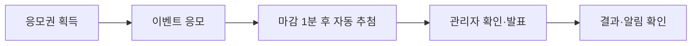
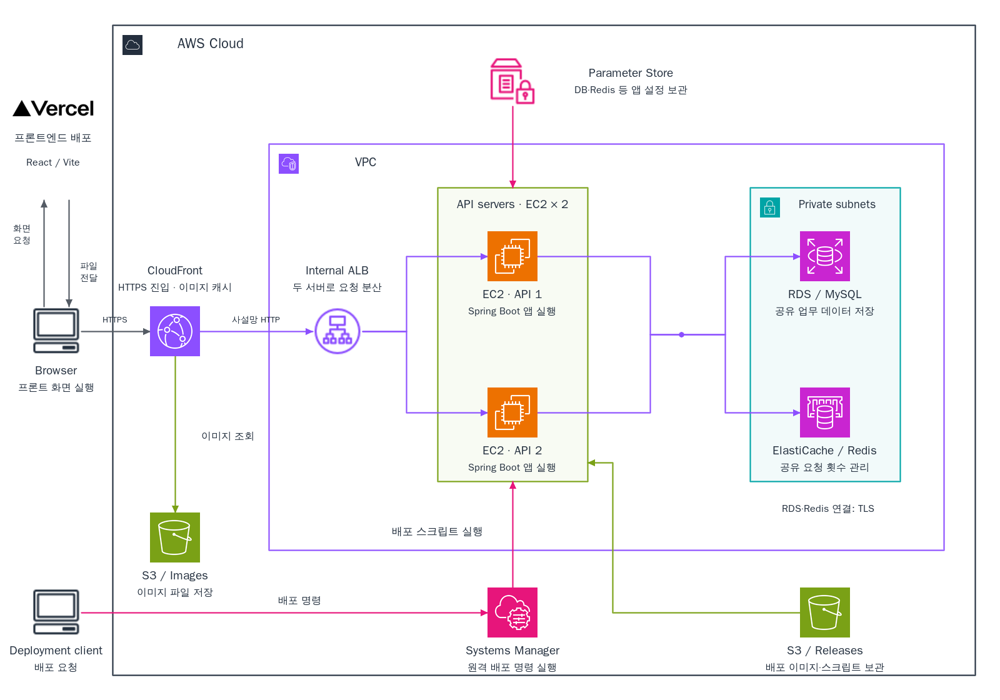
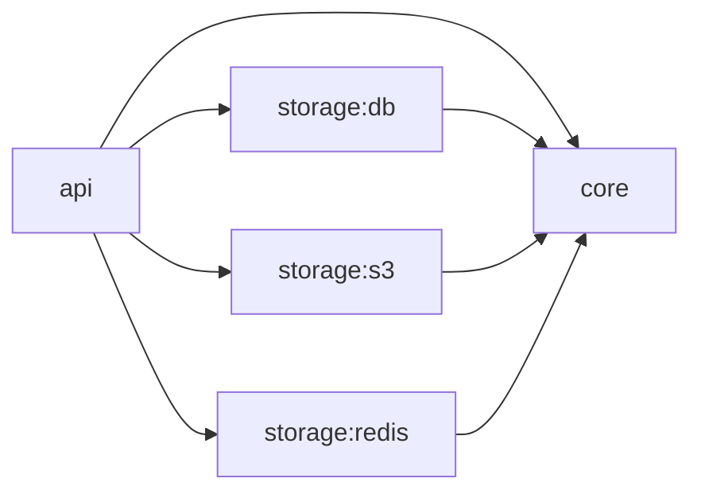
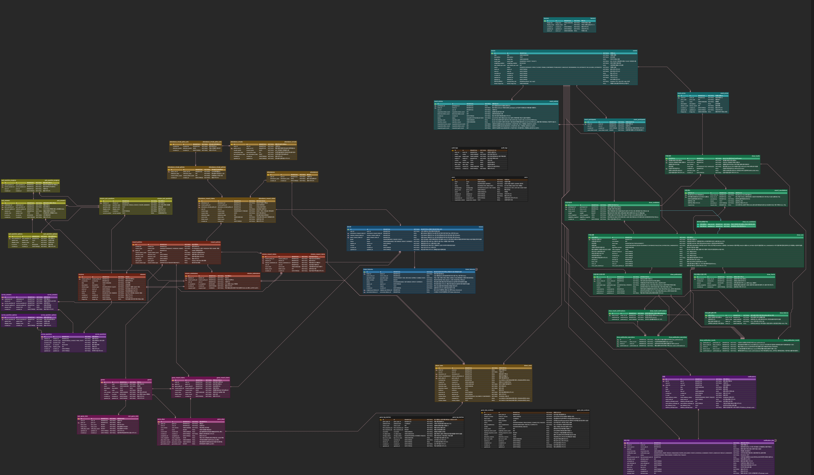
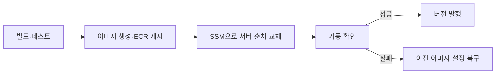
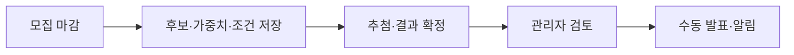
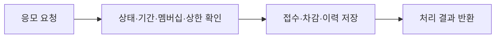
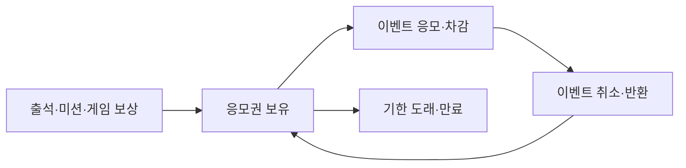

<div align="center">
  
  <h1>GETDDO Backend</h1>
  <p><strong>참여는 즐겁게, 응모와 추첨은 정확하게.</strong></p>
</div>

## 바로가기

| 구분 | 링크 |
| --- | --- |
| 서비스 | [GETDDO 사용자·관리자 화면](https://getddo-fe.vercel.app/) |
| API 문서 | [Swagger UI](https://dzc8oneey9mmx.cloudfront.net/swagger-ui/index.html) |
| 공용 명세 | [요구사항·도메인·API 계약](https://github.com/Uplus-GETDDO/getddo-spec) |
| 상세 문서 | [Backend Wiki](https://github.com/Uplus-GETDDO/getddo-be/wiki) · [구현·운영 문서](docs/) |

## 목차

1. [프로젝트 개요](#프로젝트-개요)
2. [기술 스택](#기술-스택)
3. [백엔드 팀 구성 및 역할](#백엔드-팀-구성-및-역할)
4. [아키텍처](#아키텍처)
5. [ERD](#erd)
6. [핵심 기능과 설계](#핵심-기능과-설계)
7. [정합성 검증](#정합성-검증)
8. [실행 방법](#실행-방법)

## 프로젝트 개요

GETDDO는 LG유플러스 멤버십 사용자를 위한 **이벤트 응모·추첨 플랫폼**입니다. 출석·미션·게임으로 응모권을 모으고, 이벤트에 참여해 당첨 결과를 확인합니다.

| 사용자 | 관리자 |
| --- | --- |
| 출석·퀴즈·설문·게임을 통한 응모권 획득 | 이벤트·경품·이미지·배너 관리 |
| 이벤트 조회·응모, 응모권 잔액·내역 확인 | 응모·응모권·사용자·일별 현황 조회 |
| 발표된 당첨 결과·알림 확인 | 추첨 검토·발표·재추첨, 이벤트 취소·반환 |



기본 이벤트는 `NO_TICKET`(응모권 미사용), 겟또타임은 `TICKET`(응모권 사용)입니다. 사용자 멤버십과 응모권 등급은 별개의 기준입니다.

시연은 사전 등록된 가상 사용자 선택 방식입니다. 요청의 `X-User-*` 헤더를 DB 사용자 정보와 대조하며, 별도 회원가입·로그인 토큰 발급은 제공하지 않습니다. [사용자 문맥 안내](docs/02-api/user-profile.md)

## 기술 스택

| 구분 | 기술 |
| --- | --- |
| Language |  |
| Framework |   |
| Data Access |   |
| Database |    |
| Mapping |   |
| Build |  |
| Test |     |
| DevOps |    |
| API Docs |   |

## 백엔드 팀 구성 및 역할

| 팀원 | 담당 영역 |
| --- | --- |
| 이경주 | 인프라·CI/CD·공통 기반·사용자 |
| 석종수 | 응모 자동 차단 이력·추첨·결과 공개·재추첨 |
| 전민규 | 백오피스·배너·알림·게임 |
| 윤태형 | 응모권·출석·미션·이벤트 응모·요청 빈도 제한 |
| 박지훈 | 이벤트·경품 CRUD·이미지 업로드·모집 상태 전환·취소 |

## 아키텍처

### 시스템 아키텍처

[](docs/assets/cloud-architecture.png)

### 모듈 의존 관계



| 모듈 | 역할 |
| --- | --- |
| api | HTTP 요청·입력 검증·응답 변환·애플리케이션 실행 |
| core | 도메인 모델·업무 규칙·Service·트랜잭션·Repository 계약 |
| storage:db | JPA·JDBC 저장 구현·Entity·Mapper·Flyway |
| storage:s3 | 이미지 저장과 AWS SDK 연동 |
| storage:redis | 요청 제한·응모 자동 차단·Lua 실행 |

`api`를 하나의 Spring Boot 애플리케이션으로 실행합니다. `core`는 HTTP DTO와 저장소 구현에 의존하지 않습니다.

### 패키지 구조

`<도메인>`은 `user`, `event`, `ticket` 등 기능별 패키지를 뜻합니다.

```text
getddo-be/
├── api/                                         # HTTP 요청·응답과 애플리케이션 실행
│   ├── build.gradle                             # 웹·검증·API 문서 의존성
│   └── src/
│       ├── main/
│       │   ├── java/com/getddo/api/
│       │   │   ├── GetddoBeApplication.java     # Spring Boot 진입점
│       │   │   ├── common/                      # API 공통 처리
│       │   │   │   ├── config/                  # MVC·CORS·OpenAPI 설정
│       │   │   │   ├── context/                 # 사용자 문맥 어노테이션·ArgumentResolver
│       │   │   │   ├── exception/               # 공통 API 오류 코드·전역 예외 처리
│       │   │   │   ├── ratelimit/               # 요청 제한·응모 차단 인터셉터와 설정
│       │   │   │   └── response/                # 공통 응답 형식 ResponseEnvelope
│       │   │   └── <도메인>/
│       │   │       ├── controller/              # 요청을 받아 Service에 위임
│       │   │       ├── dto/request/             # 요청 DTO와 입력 검증
│       │   │       └── dto/response/            # 응답 DTO·from(domain) 변환
│       │   └── resources/                       # application.yaml 등 실행 설정
│       ├── test/                                # DB 없는 API·설정 테스트
│       └── integrationTest/                     # 앱 기동·API·DB 연동 테스트
├── core/                                        # 도메인 모델과 비즈니스 규칙
│   ├── build.gradle                             # Spring Context·트랜잭션 의존성
│   └── src/
│       ├── main/java/com/getddo/core/
│       │   ├── common/                          # 공통 예외·페이지 조회 모델·시각 처리
│       │   └── <도메인>/
│       │       ├── domain/                      # 도메인 객체·상태·비즈니스 규칙
│       │       ├── service/                     # 업무 흐름과 트랜잭션
│       │       ├── repository/                  # 조회·저장 인터페이스
│       │       └── exception/                   # 도메인 오류 코드(ErrorCode 구현)
│       └── test/                                # 도메인 규칙·Service 테스트
├── storage/                                     # 저장소 구현 모듈의 경로 구분
│   ├── redis/                                   # Redis 제한기·Lua·연결 풀 및 Redis 전용 테스트
│   ├── s3/                                      # 이벤트·경품 이미지 S3 저장 어댑터
│   │   ├── build.gradle                         # AWS SDK 의존성
│   │   └── src/main/java/com/getddo/s3/event/    # S3 클라이언트 설정·저장 구현
│   └── db/                                      # MySQL 영속성 구현
│       ├── build.gradle                         # JPA·Flyway·MySQL 드라이버 의존성
│       └── src/
│           ├── main/
│           │   ├── java/com/getddo/db/
│           │   │   ├── common/                  # 공통 Entity·JPA Auditing 설정
│           │   │   └── <도메인>/
│           │   │       ├── entity/              # DB 테이블에 대응하는 JPA Entity
│           │   │       ├── repository/          # JpaRepository·core Repository 구현
│           │   │       └── mapper/              # Entity ↔ 도메인 객체 변환
│           │   └── resources/db/migration/      # 도메인별 Flyway SQL
│           ├── test/                            # DB 없는 영속성 관련 테스트
│           ├── integrationTest/                 # 실제 MySQL·마이그레이션 검증
│           └── testFixtures/                    # 공유 Testcontainers 설정
├── .github/                                     # GitHub 협업·자동화 설정
│   ├── pull_request_template.md                 # PR 작성 양식
│   └── workflows/                               # 빌드·테스트·이미지 생성·CD·PR 제목 검사
├── infra/                                       # 인프라 정의·배포 자동화 (Gradle 모듈과 별도)
│   └── scripts/                                 # 서버 배포·설정 조회 스크립트
│       ├── deploy-ssm.py                         # 배포 파일 전달·SSM 순차 교체·결과 확인
│       ├── deploy-container.sh                   # 설정·컨테이너 교체와 실패 복구
│       ├── publish-image.py                      # main 이미지의 ECR 게시
│       ├── prepare-image.py                      # 후보·복구 이미지 사전 준비·검증
│       ├── deploy-staging.py                     # 검증한 PR 이미지의 스테이징 배포
│       ├── fetch-app-env.py                      # Parameter Store 설정 조회·검증
│       ├── daily-release.py                      # dev CI 확인·main 병합
│       └── publish-release.py                    # 배포 성공 버전 발행
├── docs/                                        # 백엔드 API·DB·결정·작업 기록
├── gradle/wrapper/                              # Gradle 실행 버전 고정
├── compose.yaml                                 # 로컬 앱·MySQL (기본 요청 제한은 memory)
├── compose.deploy.yaml                          # 서버용 앱 컨테이너 구성
├── Dockerfile                                   # 애플리케이션 이미지 빌드
├── .env.example                                 # 로컬 환경변수 예시
├── build.gradle                                 # 모듈 공통 빌드·테스트 설정
├── settings.gradle                              # 프로젝트 이름·모듈 등록
├── gradlew                                      # macOS·Linux·WSL Gradle 실행
└── gradlew.bat                                  # Windows Gradle 실행
```

## ERD

[](docs/assets/erd-2026-10-23.png)

[최신 ERDCloud](https://www.erdcloud.com/d/TD6HcLSupbKDD9Z2E) · [원본 이미지](docs/assets/erd-2026-10-23.png) · [DBML](docs/03-database/schema.dbml) · [Flyway SQL](storage/db/src/main/resources/db/migration/)

이미지는 2026-10-23의 설계 스냅샷입니다. 이후 변경은 ERDCloud와 저장소의 DB 정의를 함께 참고합니다.

### 도메인별 ERD

| 도메인 | 테이블 수 | 내용 |
| --- | ---: | --- |
| [사용자](https://github.com/Uplus-GETDDO/getddo-be/wiki/ERD-user) | 1 | 사용자 정보·역할·멤버십 |
| [이벤트·응모](https://github.com/Uplus-GETDDO/getddo-be/wiki/ERD-event) | 6 | 이벤트·경품·응모자·응모 요청·배너·배너 카탈로그 잠금 |
| [출석](https://github.com/Uplus-GETDDO/getddo-be/wiki/ERD-attendance) | 5 | 일일·연속 출석과 보상 청구 |
| [미션](https://github.com/Uplus-GETDDO/getddo-be/wiki/ERD-mission) | 10 | 퀴즈·설문·제출·보상 청구 |
| [게임](https://github.com/Uplus-GETDDO/getddo-be/wiki/ERD-game) | 6 | 게임·플레이·통계·보상·플레이 검증 근거 |
| [보상 정책](https://github.com/Uplus-GETDDO/getddo-be/wiki/ERD-reward) | 1 | 출석·미션·게임 보상 정책과 적용 기간 |
| [응모권](https://github.com/Uplus-GETDDO/getddo-be/wiki/ERD-ticket) | 2 | 응모권 한 장의 현재 상태와 처리 이력 |
| [어뷰징 차단 이력](https://github.com/Uplus-GETDDO/getddo-be/wiki/ERD-abuse) | 1 | 응모 자동 일시 차단의 시작·종료 시각과 판정 근거 |
| [추첨·발표](https://github.com/Uplus-GETDDO/getddo-be/wiki/ERD-drawing) | 11 | 추첨 실행·후보·결과·확인·공개 버전과 실패 이력 |
| [알림](https://github.com/Uplus-GETDDO/getddo-be/wiki/ERD-notification) | 2 | 알림 생성 작업과 사용자 알림 |
| [감사 로그](https://github.com/Uplus-GETDDO/getddo-be/wiki/ERD-audit) | 1 | 변경 행위와 변경 전후 데이터 |

<a id="주요-설계"></a>
<a id="프로젝트-수행-경과"></a>

## 핵심 기능과 설계

### 인프라·CI/CD

동일한 애플리케이션 이미지를 검증·배포하고, API 서버를 순차 교체합니다. 배포 중 문제가 생기면 이전 이미지와 설정으로 복구합니다.



| 설계 포인트 | 적용 방식 |
| --- | --- |
| 검증한 이미지 재사용 | 서버에서 다시 빌드하지 않고 CI 산출물을 배포 |
| 서버별 순차 교체 | 한 서버의 기동을 확인한 뒤 다음 서버를 처리 |
| 실패 복구 | 컨테이너 교체 실패 시 보관한 이미지·설정 복구 |
| 운영 관측 | 애플리케이션 로그·DB 연결 풀·요청 지표로 상태 확인 |

상세: [CI/CD·복구](https://github.com/Uplus-GETDDO/getddo-be/wiki/CI-CD-Release-Recovery) · [Docker Compose 선택](https://github.com/Uplus-GETDDO/getddo-be/wiki/Docker-Compose-Choice) · [운영 런북](docs/06-runbook/README.md)

### 추첨·결과 공개

마감 1분 후 최초 추첨을 자동 실행하고, 관리자가 결과를 검토한 뒤 명시적으로 발표합니다. 추첨 결과 확정과 사용자 공개를 분리해 검토 전 결과 노출을 막습니다.



| 설계 포인트 | 적용 방식 |
| --- | --- |
| 추첨 근거 보존 | 실행별 후보·경품 조건·확정 결과를 스냅샷으로 저장 |
| 등급별 가중치 | 브론즈·실버·골드·플래티넘의 실제 차감 장수에 1·3·5·10을 곱해 합산 |
| 중복 당첨 방지 | 이벤트 내 같은 사용자가 다른 경품에 중복 당첨되지 않도록 선정 |
| 재추첨·실패 복구 | 기존 당첨자를 유지한 빈자리 재추첨과 동일 실행의 재시도를 구분 |

상세: [추첨·발표 흐름](https://github.com/Uplus-GETDDO/getddo-be/wiki/Mentoring-Drawing-Sequences)

### 이벤트 응모

응모권 미사용 이벤트와 응모권 사용 이벤트의 접수·추가 응모·내역 조회를 제공합니다. 접수 기록과 응모권 차감·이력을 하나의 트랜잭션에서 확정합니다.



- **동일 요청 재전송:** 요청 ID로 기존 처리 결과를 확인해 중복 접수·추가 차감을 방지합니다.
- **같은 사용자의 동시 응모:** 참여자·응모권 잠금과 DB 제약으로 보유량·누적 상한을 검사합니다.
- **마감·취소 경합:** 처리 중 상태·시각을 다시 확인하고 거절되면 접수·차감·이력을 함께 롤백합니다.

상세: [이벤트 응모 흐름](https://github.com/Uplus-GETDDO/getddo-be/wiki/Mentoring-Domain-Flows#이벤트-응모)

### 응모권

응모권 한 장의 현재 상태와 지급·사용·반환·만료 이력을 함께 관리합니다. 네 등급의 실제 장수와 추첨 가중치를 구분합니다.



| 처리 | 정합성 기준 |
| --- | --- |
| 지급 | 같은 보상 근거로 중복 지급하지 않고 최초 확정 등급 유지 |
| 차감 | 보유량·유효기간을 확인하고 응모 접수와 함께 확정 |
| 반환 | 원본 사용 이력과 연결해 같은 응모권을 원래 등급으로 한 번만 반환 |
| 만료·이력 | 만료 대상의 상태와 이력을 함께 변경하고 처리 근거 보존 |

상세: [응모권 흐름](https://github.com/Uplus-GETDDO/getddo-be/wiki/Mentoring-Domain-Flows#응모권)

### 그 밖의 기능

공통 기반·사용자·이벤트·출석·미션·요청 제한·차단 이력·알림·게임·백오피스의 구현 내용은 **[기능별 구현 상세 Wiki](https://github.com/Uplus-GETDDO/getddo-be/wiki/Feature-Implementation-Overview)** 한 페이지에서 확인할 수 있습니다.

## 정합성 검증

로컬과 API 서버 2대의 스테이징에서 동시 요청·재시도·마감·자정 경계를 시험했습니다. 아래는 2026-10-24~26 스테이징에서 측정한 대표 결과입니다.

| 시나리오 | 측정 결과 |
| --- | --- |
| 마감 직전 응모 3회 | 접수 1,522건, 접수 시각이 마감 이후인 응모 0건, 후보·접수 응모 ID 집합 일치 |
| 사용자 100명의 동시 응모 | 접수 220건 = 차감 220장 = 사용 이력 220건, 같은 키를 5번 보낸 사용자는 각 1건 접수 |
| 응모 중 이벤트 취소 2회 | 수락 26건·25건 모두 차감·반환 1:1, 거절 응모의 차감 0건 |
| 자정 전후 출석 1,000회 요청 | 총 출석 246건 = 일일 보상 청구 246건 = 지급 응모권 246장 |
| 추첨 결과 SQL 점검 | 당첨 304건에서 후보 밖 당첨·같은 실행의 중복 당첨·경품별 인원 초과 0건 |

시험별 환경·결과는 [정합성 검증 Wiki](https://github.com/Uplus-GETDDO/getddo-be/wiki/Consistency-Verification), 기능별 테스트 기록은 [테스트 Wiki](https://github.com/Uplus-GETDDO/getddo-be/wiki/Mentoring-Tests)를 참고합니다.

## 실행 방법

### Docker Compose

Docker를 준비하고 `.env.example`을 `.env`로 복사한 뒤 `DB_PASSWORD`·`MYSQL_ROOT_PASSWORD`를 입력합니다. 이미 `.env`가 있으면 기존 설정을 사용합니다.

```bash
# macOS / Linux / WSL
cp .env.example .env
# Windows PowerShell: Copy-Item .env.example .env
docker compose up --build -d
```

앱은 `http://localhost:8080`, MySQL은 `localhost:3306`에서 실행됩니다. 종료는 `docker compose down`을 사용합니다.

기본 Compose는 앱·MySQL을 실행하고, 요청 제한은 `memory` 모드를 사용합니다. Redis·S3 연동은 별도 설정이 필요합니다. [Redis 설정](docs/06-runbook/redis.md) · [이미지 업로드 설정](docs/02-api/event-images.md)

앱 시작 시 Flyway가 DB 스키마를 구성합니다. 시연 계정·이벤트·보상 정책 데이터는 별도로 준비합니다.

### 로컬 개발

JDK 21을 준비하고 `docker compose up -d db`로 MySQL을 실행합니다. DB 이름·계정·비밀번호는 `.env`와 동일하게 지정합니다.

macOS / Linux / WSL:

```bash
export SPRING_PROFILES_ACTIVE=local
export DB_HOST=localhost DB_PORT=3306
export DB_NAME=getddo DB_USERNAME=getddo
export DB_PASSWORD='<.env에 설정한 DB_PASSWORD 값>'
./gradlew :api:bootRun
```

Windows PowerShell:

```powershell
$env:SPRING_PROFILES_ACTIVE = 'local'
$env:DB_HOST = 'localhost'
$env:DB_PORT = '3306'
$env:DB_NAME = 'getddo'
$env:DB_USERNAME = 'getddo'
$env:DB_PASSWORD = '<.env에 설정한 DB_PASSWORD 값>'
.\gradlew.bat :api:bootRun
```

### 테스트

| 작업 | macOS / Linux / WSL | Windows PowerShell |
| --- | --- | --- |
| 단위 테스트 | `./gradlew test` | `.\gradlew.bat test` |
| 통합 테스트 | `./gradlew integrationTest` | `.\gradlew.bat integrationTest` |
| 전체 빌드·테스트 | `./gradlew build` | `.\gradlew.bat build` |

통합 테스트에는 Docker가 필요합니다.

실행·설정의 상세 안내: [테스트](docs/01-conventions/test-execution.md) · [이미지 업로드](docs/02-api/event-images.md) · [운영 런북](docs/06-runbook/README.md) · [기여 규칙](docs/01-conventions/README.md)
